# AWS AI — 28 Architecture Infographics and 140 Real-World Use-Case Sentences

> Complete illustrated teaching guide · 28 AWS AI services · 28 unique architecture diagrams · exactly five use-case sentences per service.

**Reading note:** These are conceptual teaching architectures, not validated deployment blueprints. Existing generated diagrams are retained where available; newly drawn diagrams use AWS-service-labeled tiles rather than third-party icons. Verify service availability, regional support, IAM permissions, and current AWS documentation before building.

## Table of contents

1. [Amazon Bedrock](#service-01)
2. [Amazon SageMaker AI](#service-02)
3. [Amazon Q Developer](#service-03)
4. [Amazon Q Business](#service-04)
5. [Amazon Bedrock Agents](#service-05)
6. [Amazon Bedrock Knowledge Bases](#service-06)
7. [Amazon Bedrock Guardrails](#service-07)
8. [Amazon Textract](#service-08)
9. [Amazon Rekognition](#service-09)
10. [Amazon Transcribe](#service-10)
11. [Amazon Polly](#service-11)
12. [Amazon Translate](#service-12)
13. [Amazon Comprehend](#service-13)
14. [Amazon Lex](#service-14)
15. [Amazon Personalize](#service-15)
16. [Amazon Forecast](#service-16)
17. [Amazon Kendra](#service-17)
18. [Amazon Connect AI capabilities](#service-18)
19. [Amazon Bedrock AgentCore](#service-19)
20. [Amazon Nova](#service-20)
21. [Amazon Titan](#service-21)
22. [Amazon Bedrock Flows](#service-22)
23. [Amazon Bedrock Data Automation](#service-23)
24. [Amazon Bedrock Prompt Management](#service-24)
25. [Amazon SageMaker Unified Studio](#service-25)
26. [AWS Trainium](#service-26)
27. [AWS Inferentia](#service-27)
28. [Strands Agents SDK](#service-28)

---

## 01. Amazon Bedrock

**Architecture focus:** Customer support knowledge assistant.

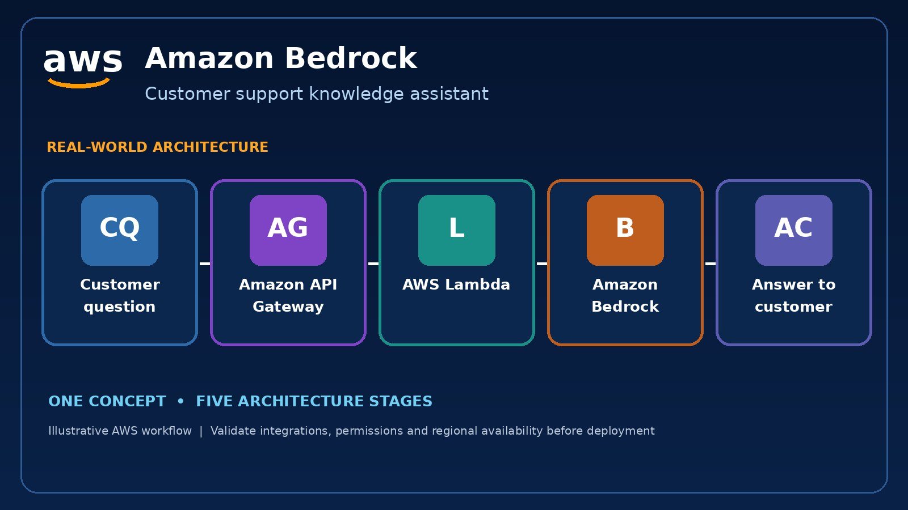

**Real-world use case — five sentences**

1. A retailer receives a customer question about the return policy through its website.
2. Amazon API Gateway forwards the request to an AWS Lambda function.
3. The function invokes a foundation model through Amazon Bedrock with approved policy context.
4. The model drafts a natural-language answer that the application returns to the customer.
5. This reduces repetitive support work while allowing staff to review complex cases.

**Architecture flow:** Customer question → Amazon API Gateway → AWS Lambda → Amazon Bedrock → Answer to customer.

---

## 02. Amazon SageMaker AI

**Architecture focus:** Real-time credit-card fraud scoring.

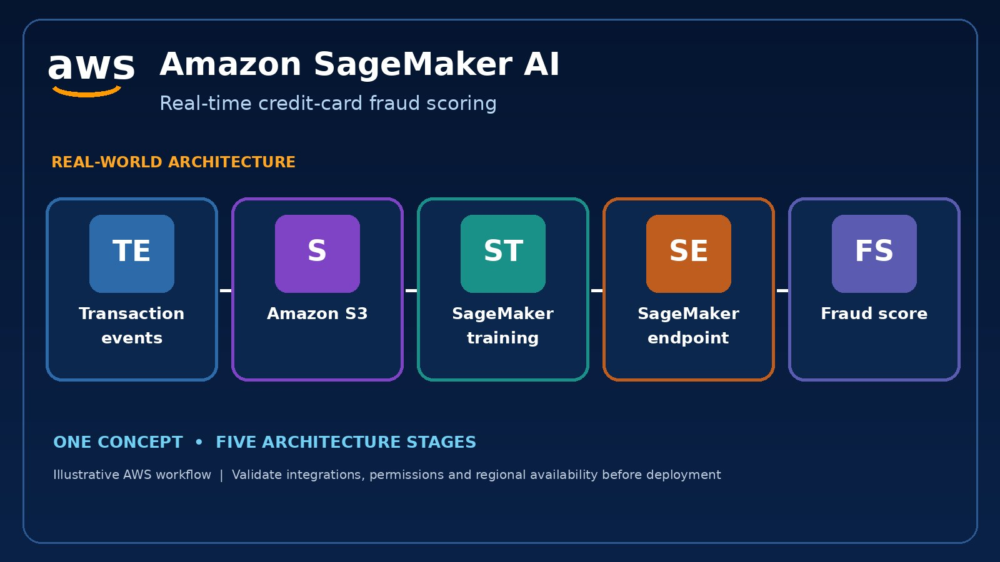

**Real-world use case — five sentences**

1. A payment processor collects labeled transaction history for fraud detection.
2. The data is prepared in Amazon S3 for model training with Amazon SageMaker AI.
3. A trained classification model is deployed to a SageMaker inference endpoint.
4. New transactions receive a fraud-risk score before the payment decision is finalized.
5. The risk team monitors false positives and periodically retrains the model.

**Architecture flow:** Transaction events → Amazon S3 → SageMaker training → SageMaker endpoint → Fraud score.

---

## 03. Amazon Q Developer

**Architecture focus:** AI-assisted cloud application development.

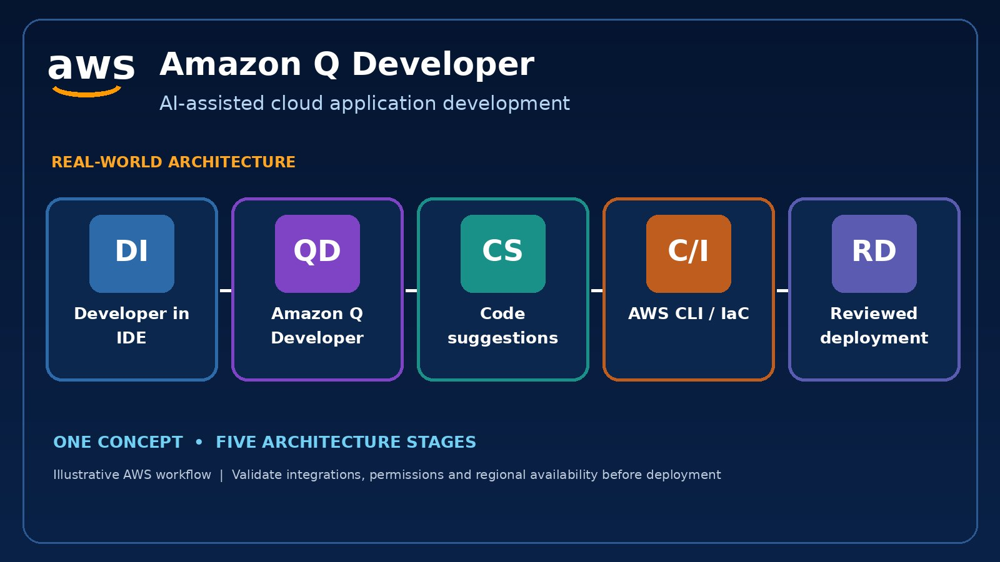

**Real-world use case — five sentences**

1. A developer needs to add an Amazon S3 upload feature to a web application.
2. Amazon Q Developer suggests code and explains the AWS permissions the feature may require.
3. The developer reviews the suggestions and adds tests before committing the change.
4. The team uses its normal CI pipeline to validate and deploy the application.
5. This accelerates routine implementation without replacing code review or security checks.

**Architecture flow:** Developer in IDE → Amazon Q Developer → Code suggestions → AWS CLI / IaC → Reviewed deployment.

---

## 04. Amazon Q Business

**Architecture focus:** Internal HR policy question answering.

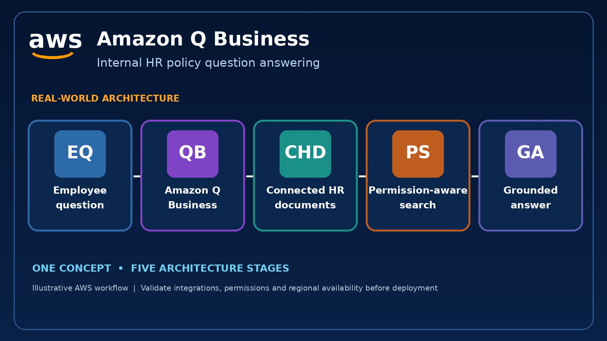

**Real-world use case — five sentences**

1. An employee asks how many days of parental leave are available under company policy.
2. Amazon Q Business searches connected HR documents that the employee is permitted to access.
3. The assistant retrieves relevant policy passages and generates a concise answer.
4. The employee follows the cited document to verify eligibility details.
5. This saves time spent searching across internal portals and shared drives.

**Architecture flow:** Employee question → Amazon Q Business → Connected HR documents → Permission-aware search → Grounded answer.

---

## 05. Amazon Bedrock Agents

**Architecture focus:** Automated order status support.

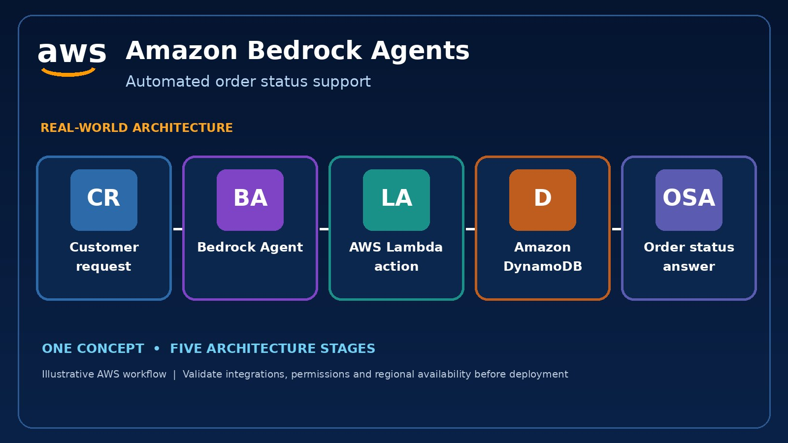

**Real-world use case — five sentences**

1. A shopper asks an online store where an order is currently located.
2. An Amazon Bedrock Agent interprets the request and selects an approved order-lookup action.
3. The action invokes AWS Lambda to query the order record in Amazon DynamoDB.
4. The agent uses the returned order status to prepare a clear response.
5. This supports task-oriented customer service without giving the model direct database credentials.

**Architecture flow:** Customer request → Bedrock Agent → AWS Lambda action → Amazon DynamoDB → Order status answer.

---

## 06. Amazon Bedrock Knowledge Bases

**Architecture focus:** RAG assistant for company PDFs.

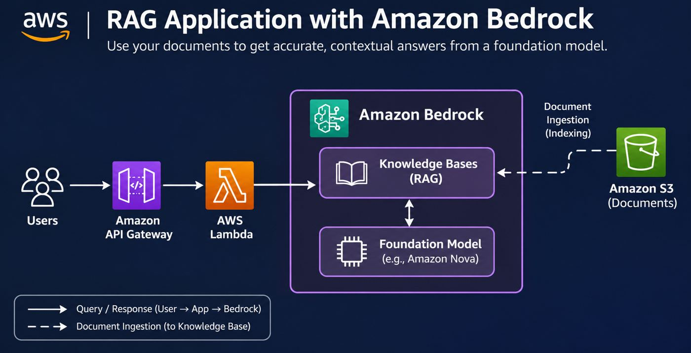

**Real-world use case — five sentences**

1. An IT engineer asks a chatbot how to request temporary production access.
2. Amazon Bedrock Knowledge Bases indexes internal policy documents stored in Amazon S3.
3. The application retrieves relevant passages and supplies them to a foundation model.
4. The model answers the question using the retrieved company guidance.
5. This is useful for internal runbooks, HR policies, and technical knowledge assistants.

**Architecture flow:** Policy PDFs in S3 → Knowledge Base sync → Vector retrieval → Bedrock model → Grounded answer.

---

## 07. Amazon Bedrock Guardrails

**Architecture focus:** Safety filtering for a bank chatbot.

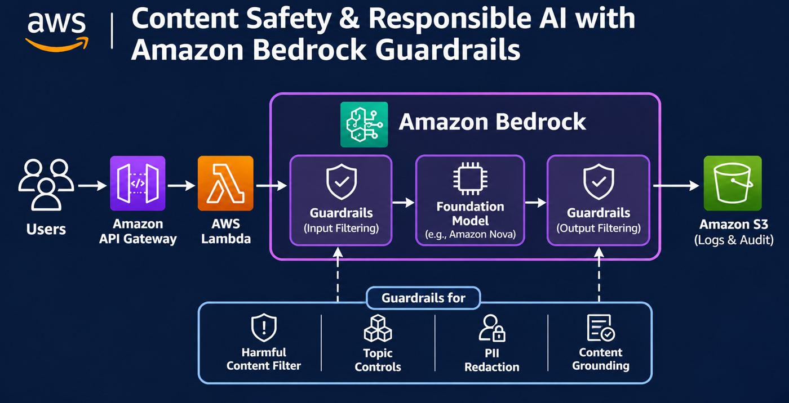

**Real-world use case — five sentences**

1. A bank deploys a generative AI chatbot for general account-service questions.
2. Amazon Bedrock Guardrails evaluates the request against configured content and topic rules.
3. The application sends allowed requests to its selected foundation model.
4. Guardrails can also assess the model response before it reaches the customer.
5. The bank uses this control alongside authentication, auditing, and human escalation.

**Architecture flow:** Customer message → Bedrock Guardrails → Foundation model → Response screening → Safe reply.

---

## 08. Amazon Textract

**Architecture focus:** Invoice data extraction.

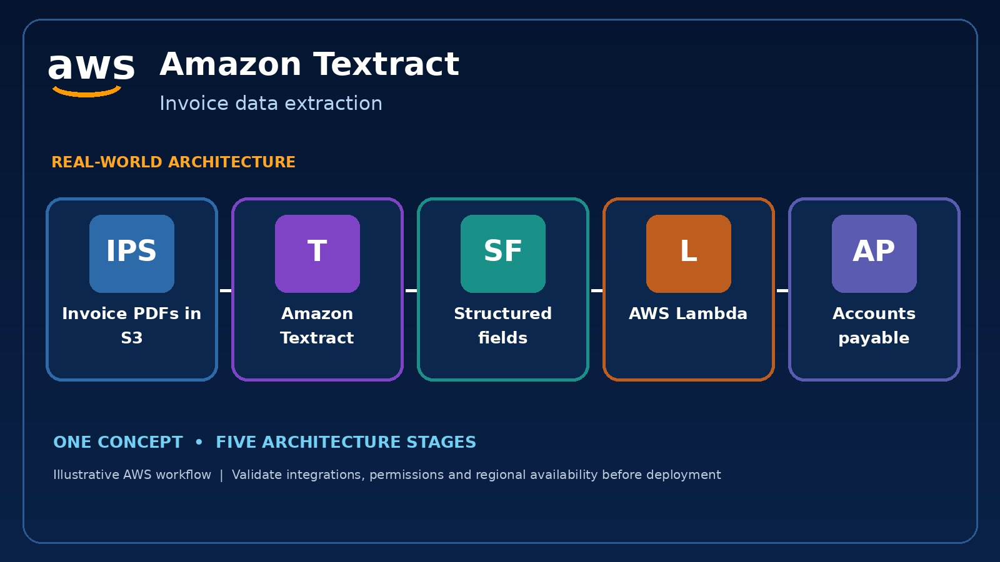

**Real-world use case — five sentences**

1. An accounts-payable team receives hundreds of supplier invoices as PDF files.
2. Each invoice is uploaded to Amazon S3 for automated processing.
3. Amazon Textract extracts text, tables, and invoice fields from the documents.
4. AWS Lambda validates the extracted values before sending them to the finance workflow.
5. This reduces manual data entry while keeping exceptions available for human review.

**Architecture flow:** Invoice PDFs in S3 → Amazon Textract → Structured fields → AWS Lambda → Accounts payable.

---

## 09. Amazon Rekognition

**Architecture focus:** Product image moderation.

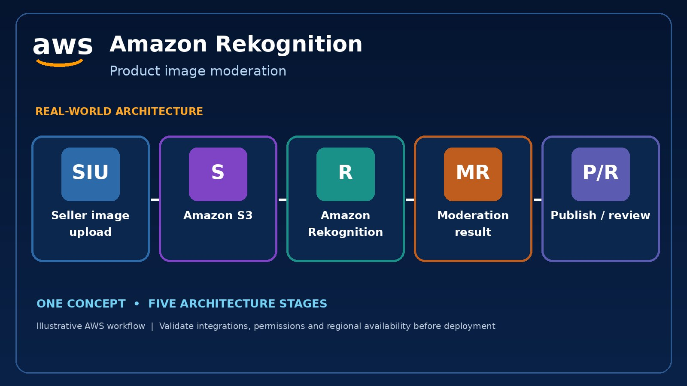

**Real-world use case — five sentences**

1. An online marketplace lets sellers upload product photographs.
2. The images are stored in Amazon S3 before they appear in public listings.
3. Amazon Rekognition analyzes images for configured moderation categories.
4. The application routes flagged images to a human reviewer instead of publishing them automatically.
5. This helps the marketplace scale image review while retaining human oversight.

**Architecture flow:** Seller image upload → Amazon S3 → Amazon Rekognition → Moderation result → Publish / review.

---

## 10. Amazon Transcribe

**Architecture focus:** Call center conversation transcription.

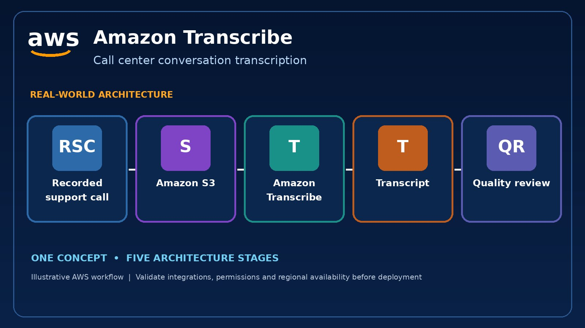

**Real-world use case — five sentences**

1. A support center records customer calls with appropriate notice and consent.
2. The recordings are stored in Amazon S3 for controlled processing.
3. Amazon Transcribe converts the speech into searchable text transcripts.
4. Supervisors use transcripts to identify common questions and review service quality.
5. This reduces manual transcription effort and makes call records easier to analyze.

**Architecture flow:** Recorded support call → Amazon S3 → Amazon Transcribe → Transcript → Quality review.

---

## 11. Amazon Polly

**Architecture focus:** Voice-enabled appointment reminders.

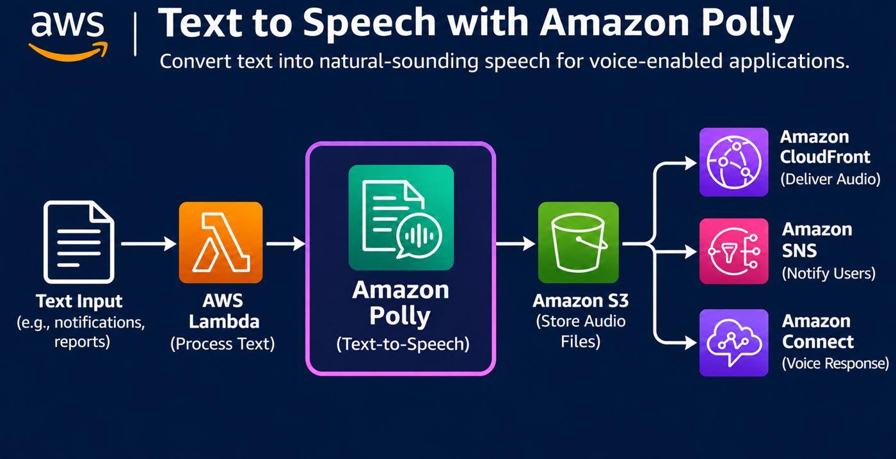

**Real-world use case — five sentences**

1. A healthcare appointment system prepares a reminder message for each scheduled visit.
2. AWS Lambda sends the approved reminder text to Amazon Polly.
3. Amazon Polly converts the text into speech audio.
4. The application stores or streams the audio for playback through its notification channel.
5. This enables accessible spoken reminders without recording each message manually.

**Architecture flow:** Reminder text → AWS Lambda → Amazon Polly → Speech audio in S3 → Voice playback.

---

## 12. Amazon Translate

**Architecture focus:** Multilingual customer support.

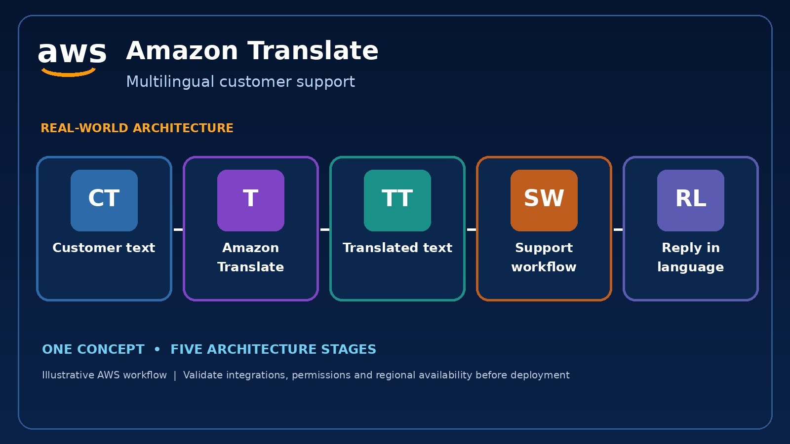

**Real-world use case — five sentences**

1. A global retailer receives a customer support message written in Tamil.
2. Amazon Translate converts the message into the support team’s working language.
3. The agent prepares an answer using the translated message and customer context.
4. The response is translated back into Tamil before being sent to the customer.
5. This allows multilingual support teams to handle common inquiries more efficiently.

**Architecture flow:** Customer text → Amazon Translate → Translated text → Support workflow → Reply in language.

---

## 13. Amazon Comprehend

**Architecture focus:** Sentiment analysis of customer reviews.

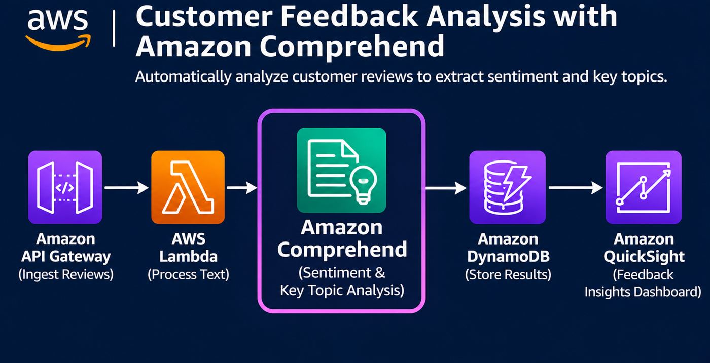

**Real-world use case — five sentences**

1. An e-commerce business collects written customer reviews about recent purchases.
2. Amazon Comprehend identifies sentiment and useful entities in the review text.
3. The analysis results are stored with the original review identifiers.
4. Analysts query the results to spot products receiving unusually negative feedback.
5. Product teams use these insights to prioritize quality improvements.

**Architecture flow:** Reviews in S3 → Amazon Comprehend → Sentiment labels → Amazon Athena → Product insights.

---

## 14. Amazon Lex

**Architecture focus:** Self-service delivery-status chatbot.

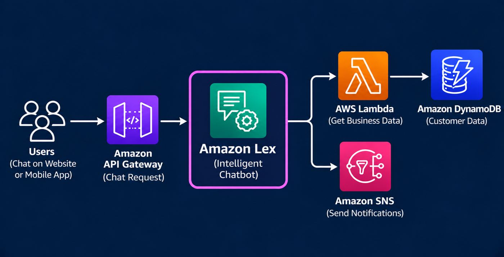

**Real-world use case — five sentences**

1. A customer asks a delivery chatbot to track a parcel.
2. Amazon Lex recognizes the tracking intent and collects the required order identifier.
3. A Lambda fulfillment function retrieves the current delivery status.
4. Lex presents the result in a conversational response.
5. This automates frequent support requests while escalating unsupported cases to an agent.

**Architecture flow:** Customer chat → Amazon Lex → Intent + slots → AWS Lambda → Order status.

---

## 15. Amazon Personalize

**Architecture focus:** Product recommendations for shoppers.

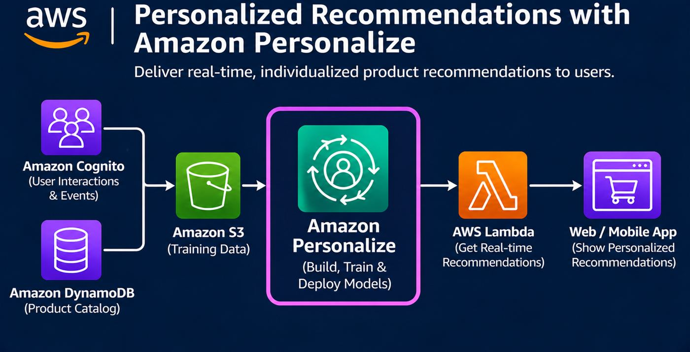

**Real-world use case — five sentences**

1. An online store captures product views and purchases as interaction events.
2. Amazon Personalize uses eligible interaction and catalog data to build recommendation models.
3. The storefront requests recommendations for a signed-in shopper.
4. The application displays relevant products in a personalized recommendation shelf.
5. The merchandising team measures engagement and conversion against a baseline.

**Architecture flow:** Browsing events → Amazon Personalize → Recommendation API → Product catalog → Personalized shelf.

---

## 16. Amazon Forecast

**Architecture focus:** Retail demand forecasting (legacy).

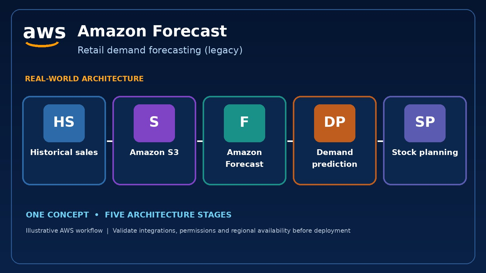

**Real-world use case — five sentences**

1. A retail planner reviews historical sales and seasonal demand for popular items.
2. In an existing supported environment, Amazon Forecast can generate time-series demand predictions.
3. The forecast output is compared with current inventory and supplier lead times.
4. Planners use the estimates to decide how much stock to replenish.
5. Because Amazon Forecast is closed to new customers, new implementations should evaluate supported forecasting alternatives.

**Architecture flow:** Historical sales → Amazon S3 → Amazon Forecast → Demand prediction → Stock planning.

---

## 17. Amazon Kendra

**Architecture focus:** Enterprise document search.

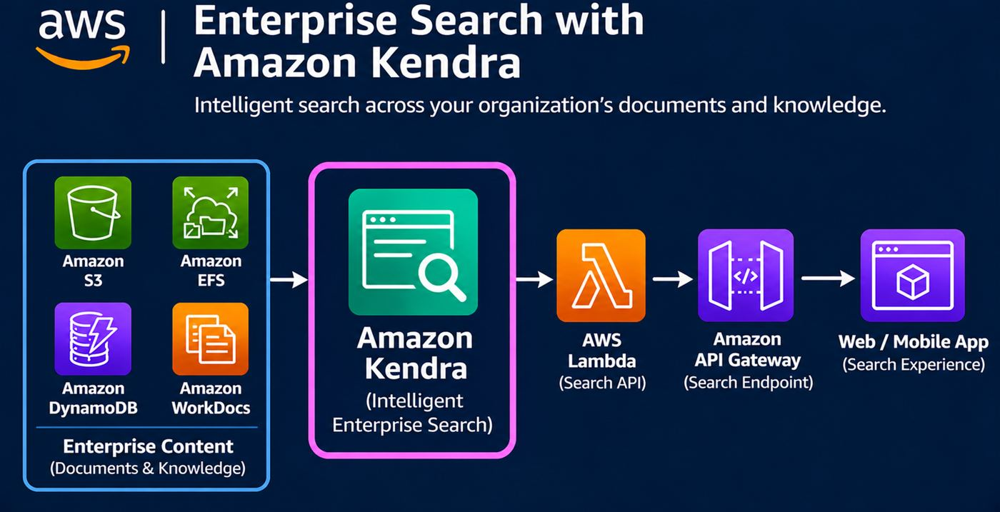

**Real-world use case — five sentences**

1. An employee needs the latest troubleshooting procedure for a production service.
2. Amazon Kendra indexes permitted enterprise documents from supported repositories.
3. The employee submits a natural-language search query through the internal portal.
4. Kendra returns relevant results that link to the source documents.
5. This helps teams find runbooks and policies without searching every repository manually.

**Architecture flow:** Employee search → Amazon Kendra → Indexed documents → Ranked passages → Search results.

---

## 18. Amazon Connect AI capabilities

**Architecture focus:** AI-assisted contact center.

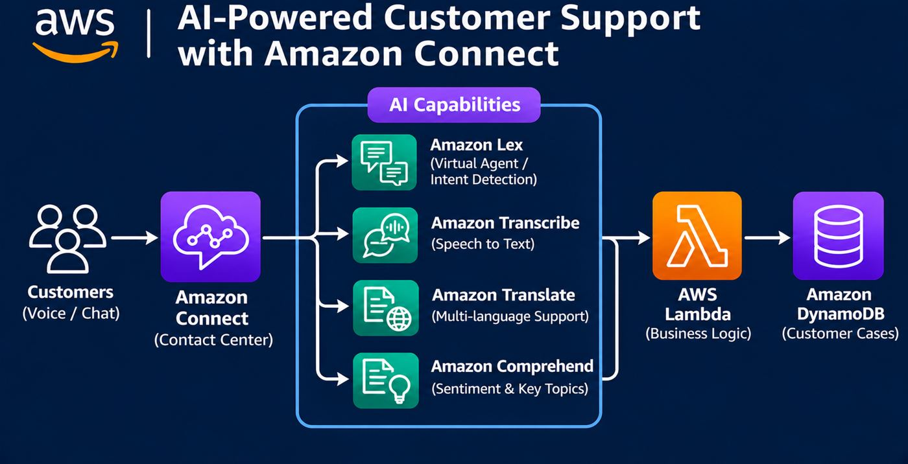

**Real-world use case — five sentences**

1. A customer calls a retailer to change the delivery address of an order.
2. Amazon Connect routes the call and presents the agent with customer context.
3. Configured AI capabilities can assist with self-service, summaries, or agent guidance.
4. An authorized Lambda integration checks whether the requested change is still permitted.
5. The agent confirms the outcome and the case record is updated.

**Architecture flow:** Customer call → Amazon Connect → AI agent assistance → AWS Lambda → Resolved case.

---

## 19. Amazon Bedrock AgentCore

**Architecture focus:** Secure runtime for an operations agent.

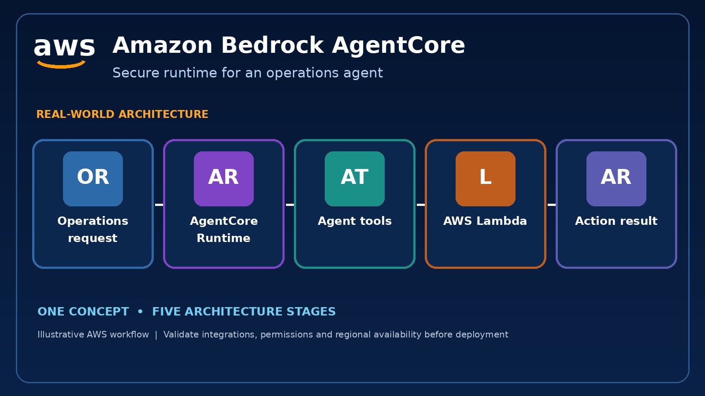

**Real-world use case — five sentences**

1. An operations engineer asks an internal AI agent to check a failed deployment.
2. Amazon Bedrock AgentCore Runtime hosts the agent application in a managed execution environment.
3. The agent invokes approved tools to inspect deployment metadata and recent errors.
4. A Lambda action can retrieve additional diagnostic information under restricted permissions.
5. The engineer receives a summary and decides whether to approve any corrective action.

**Architecture flow:** Operations request → AgentCore Runtime → Agent tools → AWS Lambda → Action result.

---

## 20. Amazon Nova

**Architecture focus:** Multimodal product content analysis.

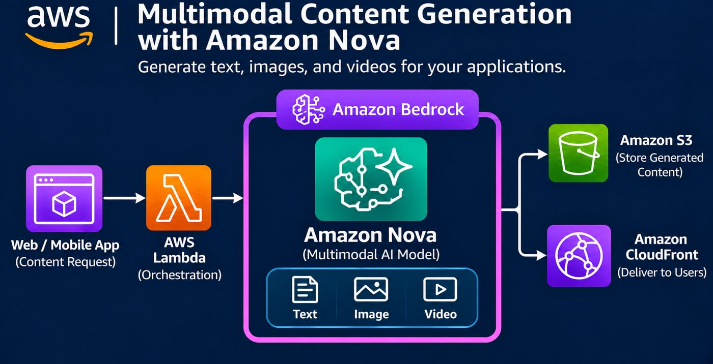

**Real-world use case — five sentences**

1. A marketplace seller uploads a product photo with a short title.
2. The application sends the supported image and text input to an Amazon Nova model through Amazon Bedrock.
3. The model drafts a product description based on the supplied content.
4. The seller reviews the generated description before publishing it.
5. This helps merchants create consistent product content more quickly.

**Architecture flow:** Product photo + text → AWS Lambda → Amazon Bedrock → Amazon Nova → Product description.

---

## 21. Amazon Titan

**Architecture focus:** Semantic document search embeddings.

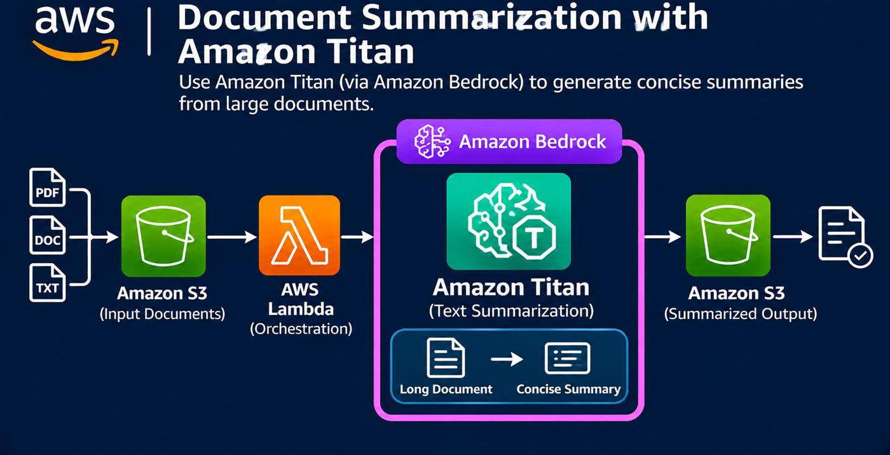

**Real-world use case — five sentences**

1. A legal operations team needs to find clauses that resemble a new contract requirement.
2. Amazon Titan Embeddings converts approved document passages into numerical vectors.
3. The vectors are stored in a compatible vector index for similarity search.
4. A user query is embedded and matched against the indexed passages.
5. Reviewers inspect the returned clauses before making legal decisions.

**Architecture flow:** Documents in S3 → Titan Embeddings → Vector index → Similarity search → Relevant passages.

---

## 22. Amazon Bedrock Flows

**Architecture focus:** Multi-step insurance claim triage.

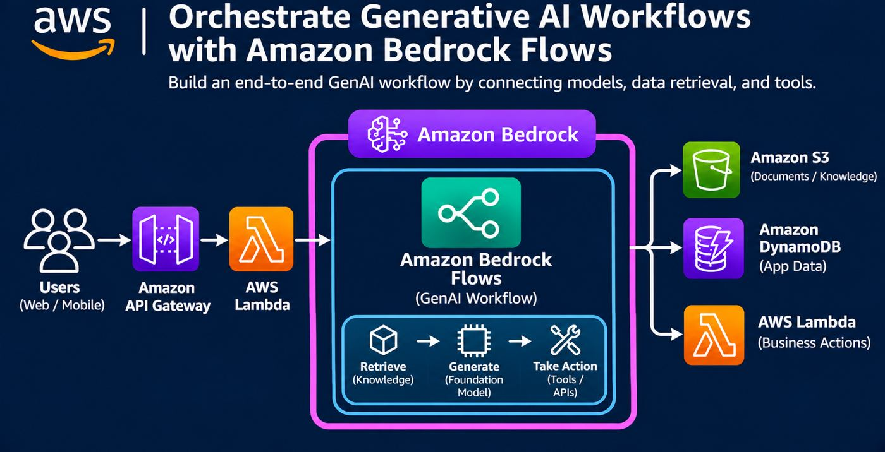

**Real-world use case — five sentences**

1. An insurer receives a new claim description from a customer portal.
2. Amazon Bedrock Flows coordinates policy retrieval and foundation-model classification steps.
3. The workflow gathers the information needed to categorize the request.
4. A connected action routes the claim to the appropriate review queue.
5. Human adjusters make coverage and payment decisions using the supporting evidence.

**Architecture flow:** Claim request → Bedrock Flows → Retrieve policy → Model classification → Route claim.

---

## 23. Amazon Bedrock Data Automation

**Architecture focus:** Structured extraction from receipts.

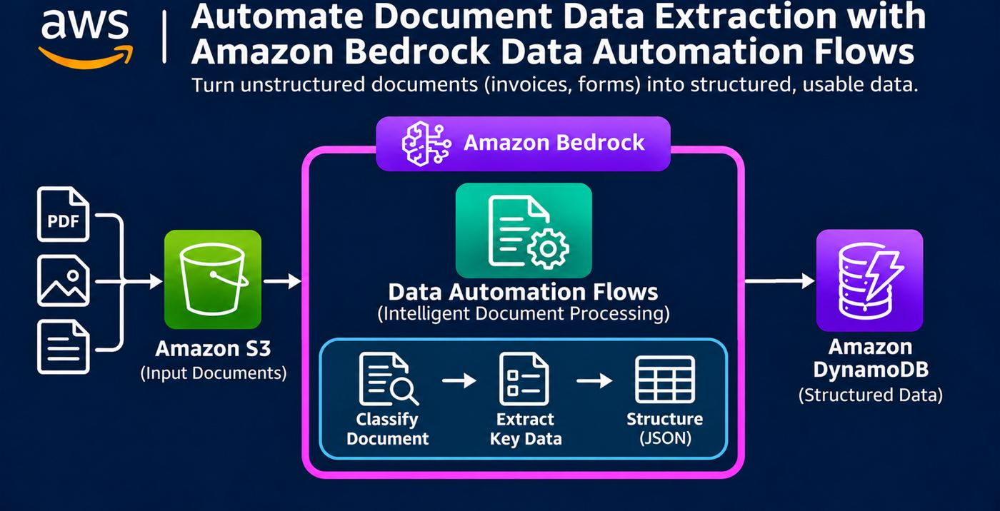

**Real-world use case — five sentences**

1. Employees submit photographed receipts for reimbursement.
2. Amazon Bedrock Data Automation processes the uploaded documents and extracts relevant fields.
3. The application receives structured values such as merchant, date, and total when available.
4. AWS Lambda checks required fields and sends incomplete records for review.
5. This speeds up expense processing while preserving a validation step.

**Architecture flow:** Receipt files in S3 → Bedrock Data Automation → Extracted fields → AWS Lambda → Expense records.

---

## 24. Amazon Bedrock Prompt Management

**Architecture focus:** Version-controlled support prompts.

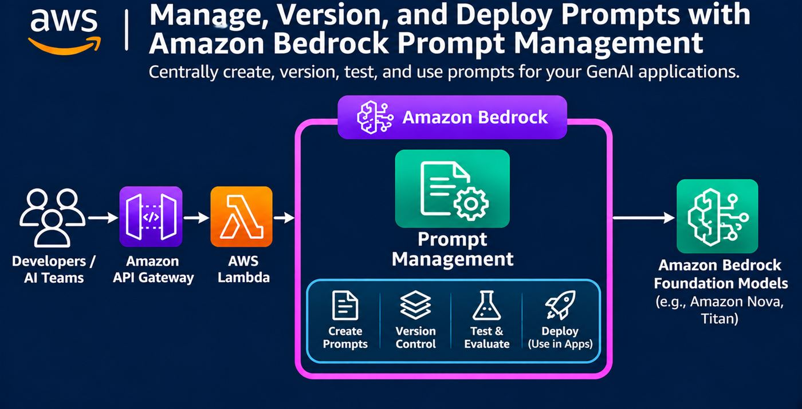

**Real-world use case — five sentences**

1. A support engineering team maintains a standardized prompt for customer email drafts.
2. Amazon Bedrock Prompt Management stores reusable prompt templates and their versions.
3. Developers test a new version with representative customer scenarios.
4. The application invokes an approved prompt version with the chosen foundation model.
5. Versioning makes it easier to track changes and roll back problematic prompt updates.

**Architecture flow:** Prompt author → Prompt Management → Prompt version → Bedrock model → Support reply.

---

## 25. Amazon SageMaker Unified Studio

**Architecture focus:** Collaborative churn prediction.

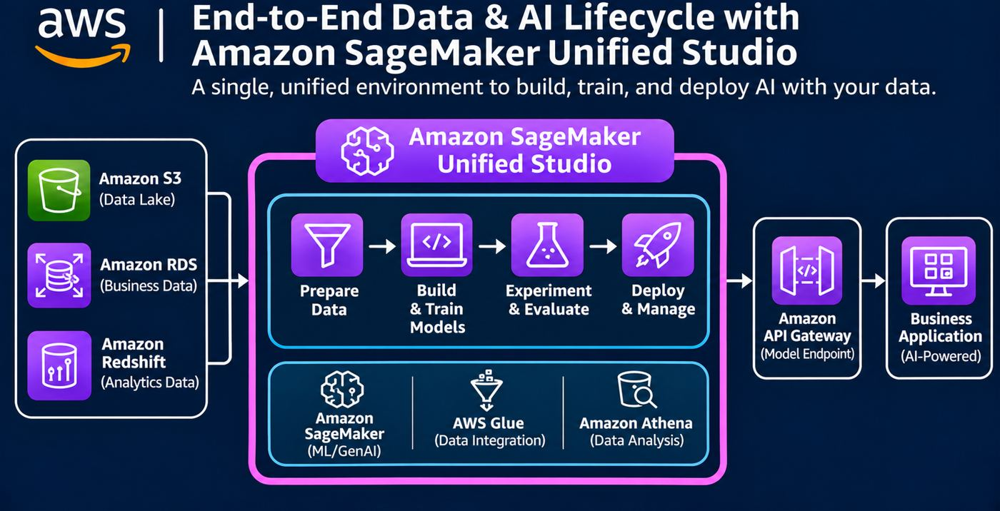

**Real-world use case — five sentences**

1. A subscription business wants to identify customers at risk of cancellation.
2. Analysts use Amazon SageMaker Unified Studio to discover and work with authorized data.
3. The team prepares features and develops a churn model using integrated AWS capabilities.
4. The model is evaluated before its predictions are used in a retention workflow.
5. This gives data and AI teams a shared environment for coordinated development.

**Architecture flow:** Customer data in S3 → Unified Studio → Prepare features → SageMaker AI → Churn predictions.

---

## 26. AWS Trainium

**Architecture focus:** Training a domain language model.

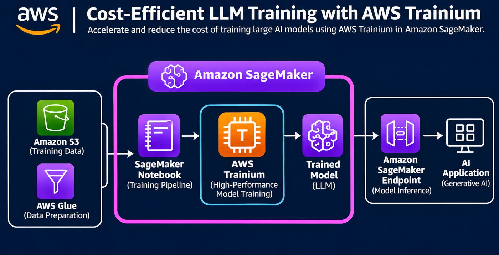

**Real-world use case — five sentences**

1. An AI research team trains a domain-specific language model using an approved text corpus.
2. The training dataset is stored in Amazon S3 and prepared for distributed processing.
3. Compatible training software runs on AWS Trainium-based compute instances.
4. The team saves checkpoints and evaluates the model against benchmark tasks.
5. Trainium can improve training economics for workloads optimized for its hardware and software stack.

**Architecture flow:** Training corpus in S3 → Amazon SageMaker AI → Trainium compute → Model checkpoints → Trained model.

---

## 27. AWS Inferentia

**Architecture focus:** Low-latency image classification inference.

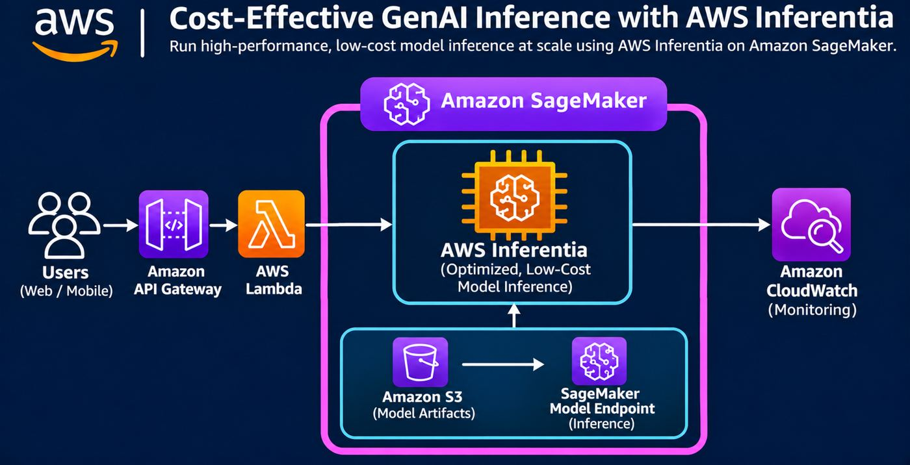

**Real-world use case — five sentences**

1. A manufacturing inspection application submits product images for defect classification.
2. The request reaches an inference service through a controlled API.
3. A compatible model runs on AWS Inferentia-powered instances.
4. The service returns a defect prediction to the inspection application.
5. The team monitors latency, throughput, and accuracy to assess production suitability.

**Architecture flow:** Image request → Amazon API Gateway → Inference service → Inferentia compute → Prediction.

---

## 28. Strands Agents SDK

**Architecture focus:** Incident investigation agent.

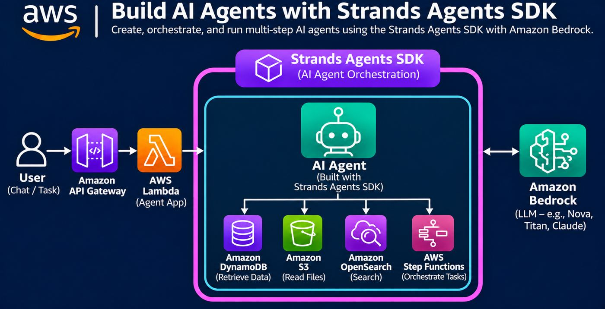

**Real-world use case — five sentences**

1. An SRE asks an incident assistant why an application started returning errors.
2. A Strands Agents SDK application coordinates the model and approved diagnostic tools.
3. The agent retrieves relevant logs, metrics, and deployment metadata using read-only permissions.
4. The model summarizes likely causes and links the supporting evidence.
5. An engineer validates the findings before making changes to production.

**Architecture flow:** Incident question → Strands agent → Bedrock model → Read-only AWS tools → Incident summary.

---

## Completeness audit

- 28 distinct AWS AI services, matching the requested list.
- 28 embedded infographic images, one per service.
- 140 individually authored real-world use-case sentences, five per service.
- 17 previously generated infographic images reused, 11 new diagrams created.
- All image paths are relative to this Markdown file.
