# AWS AI — 28 Architecture Infographics

> All service icons in these diagrams are sourced exclusively from the AWS Architecture Icons package supplied with this guide. Non-service inputs and outputs are represented by text-only boxes; no substitute icons are used.

## Contents

1. [Amazon Bedrock](#1-amazon-bedrock)
2. [Amazon SageMaker AI](#2-amazon-sagemaker-ai)
3. [Amazon Q Developer](#3-amazon-q-developer)
4. [Amazon Q Business](#4-amazon-q-business)
5. [Amazon Bedrock Agents](#5-amazon-bedrock-agents)
6. [Amazon Bedrock Knowledge Bases](#6-amazon-bedrock-knowledge-bases)
7. [Amazon Bedrock Guardrails](#7-amazon-bedrock-guardrails)
8. [Amazon Textract](#8-amazon-textract)
9. [Amazon Rekognition](#9-amazon-rekognition)
10. [Amazon Transcribe](#10-amazon-transcribe)
11. [Amazon Polly](#11-amazon-polly)
12. [Amazon Translate](#12-amazon-translate)
13. [Amazon Comprehend](#13-amazon-comprehend)
14. [Amazon Lex](#14-amazon-lex)
15. [Amazon Personalize](#15-amazon-personalize)
16. [Amazon Forecast](#16-amazon-forecast)
17. [Amazon Kendra](#17-amazon-kendra)
18. [Amazon Connect AI capabilities](#18-amazon-connect-ai-capabilities)
19. [Amazon Bedrock AgentCore](#19-amazon-bedrock-agentcore)
20. [Amazon Nova](#20-amazon-nova)
21. [Amazon Titan](#21-amazon-titan)
22. [Amazon Bedrock Flows](#22-amazon-bedrock-flows)
23. [Amazon Bedrock Data Automation](#23-amazon-bedrock-data-automation)
24. [Amazon Bedrock Prompt Management](#24-amazon-bedrock-prompt-management)
25. [Amazon SageMaker Unified Studio](#25-amazon-sagemaker-unified-studio)
26. [AWS Trainium](#26-aws-trainium)
27. [AWS Inferentia](#27-aws-inferentia)
28. [Strands Agents SDK](#28-strands-agents-sdk)

---

## 1. Amazon Bedrock

**Architecture focus:** Customer support answer generation.

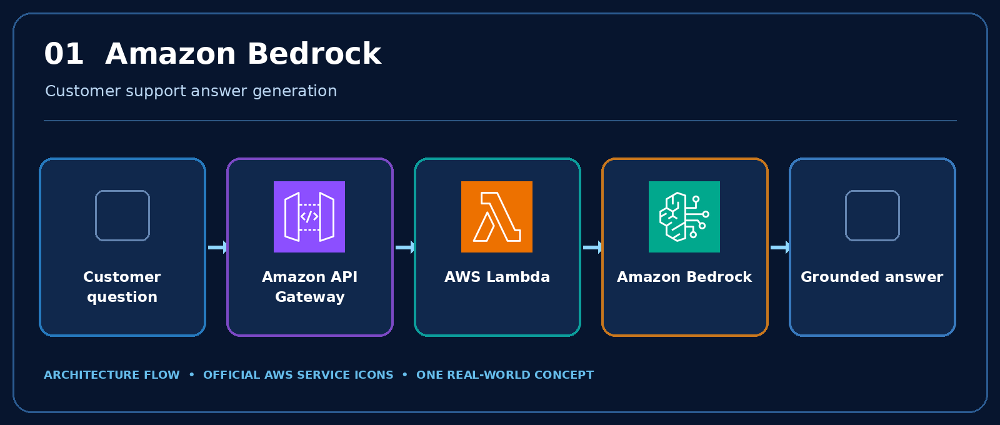

**Real-world use case — five sentences**

1. A retailer receives a customer question about a delayed order through its support portal.
2. Amazon API Gateway passes the request to an AWS Lambda function that validates the customer session.
3. The function calls Amazon Bedrock to generate a helpful response using an approved foundation model.
4. The application can add order details from authorized systems before presenting the answer.
5. Support teams monitor response quality and escalate unusual cases to a human agent.

**Architecture flow:** Customer question → Amazon API Gateway → AWS Lambda → Amazon Bedrock → Grounded answer.

---

## 2. Amazon SageMaker AI

**Architecture focus:** Card transaction fraud detection.

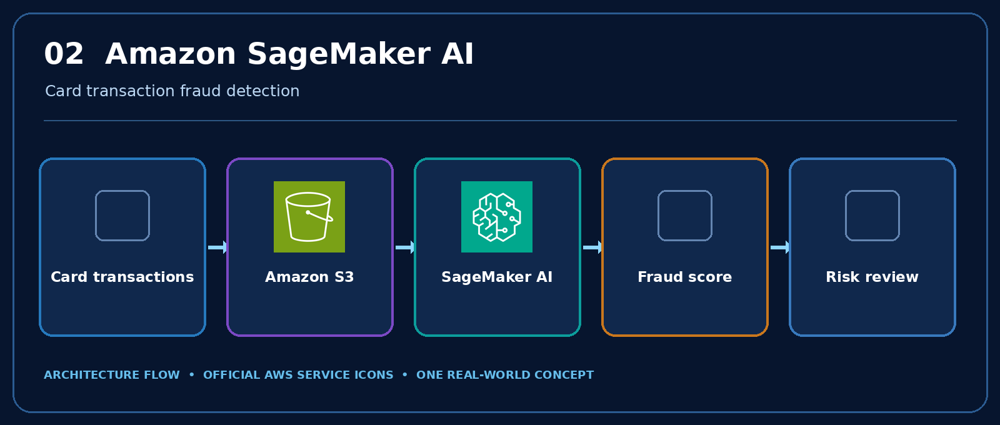

**Real-world use case — five sentences**

1. A bank collects historical card transactions and confirmed fraud labels for model development.
2. Data scientists prepare those records in Amazon S3 and train a fraud classifier with SageMaker AI.
3. The trained model assigns a fraud probability to each new transaction.
4. Transactions above a defined risk threshold are routed for additional verification.
5. Analysts compare predictions with confirmed outcomes to monitor drift and retrain the model.

**Architecture flow:** Card transactions → Amazon S3 → SageMaker AI → Fraud score → Risk review.

---

## 3. Amazon Q Developer

**Architecture focus:** Developer troubleshooting in AWS.

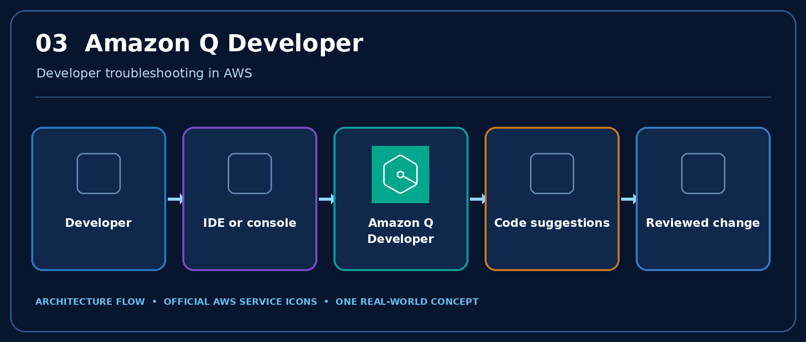

**Real-world use case — five sentences**

1. A developer encounters a deployment error while updating an AWS application.
2. Amazon Q Developer helps explain the error and suggests code or configuration changes.
3. The developer reviews the suggested changes against the project requirements and security policies.
4. Automated tests validate the revised code before it is merged.
5. The team tracks whether the assistance reduces troubleshooting time without compromising code quality.

**Architecture flow:** Developer → IDE or console → Amazon Q Developer → Code suggestions → Reviewed change.

---

## 4. Amazon Q Business

**Architecture focus:** Enterprise policy knowledge assistant.

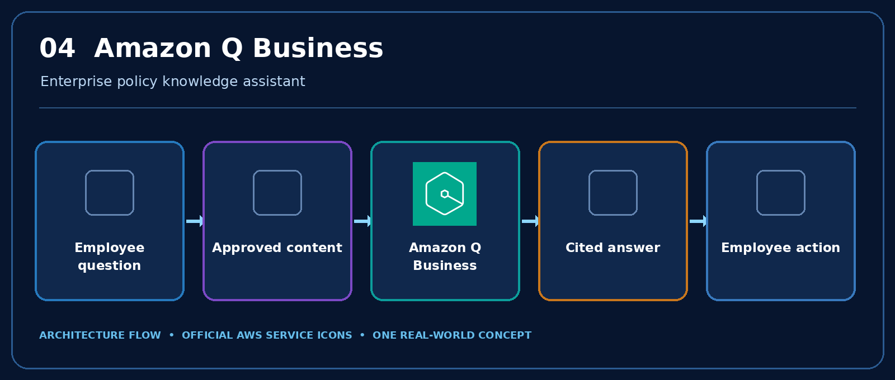

**Real-world use case — five sentences**

1. An employee needs the latest travel reimbursement policy from internal company documents.
2. Amazon Q Business searches connected enterprise content according to the user’s access permissions.
3. It returns a summarized answer with references to relevant source material.
4. The employee opens the source document to verify policy details before submitting an expense.
5. Administrators maintain connectors and access controls as the company updates its policies.

**Architecture flow:** Employee question → Approved content → Amazon Q Business → Cited answer → Employee action.

---

## 5. Amazon Bedrock Agents

**Architecture focus:** Automated order status resolution.

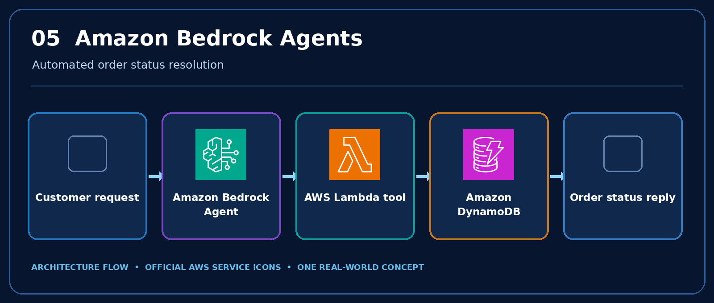

**Real-world use case — five sentences**

1. A customer asks a shopping assistant to check the status of an order.
2. An Amazon Bedrock agent determines that it needs to retrieve current order information.
3. The agent invokes an authorized Lambda action that queries an order record in DynamoDB.
4. The application presents the status in plain language without exposing other customers’ data.
5. Requests requiring refunds or account changes are subject to additional authorization checks.

**Architecture flow:** Customer request → Amazon Bedrock Agent → AWS Lambda tool → Amazon DynamoDB → Order status reply.

---

## 6. Amazon Bedrock Knowledge Bases

**Architecture focus:** RAG over product manuals.

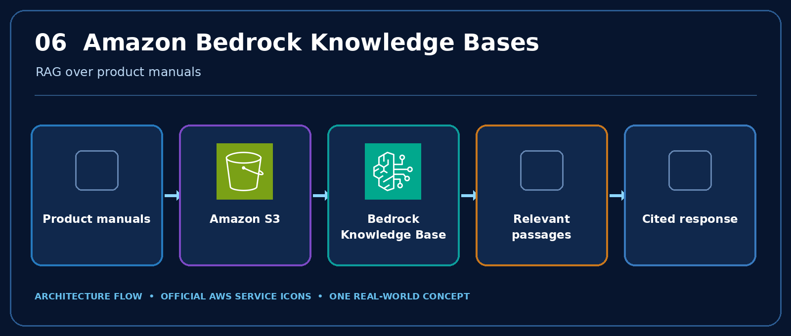

**Real-world use case — five sentences**

1. A manufacturer stores approved troubleshooting manuals in Amazon S3.
2. A Bedrock Knowledge Base indexes the content for semantic retrieval.
3. A technician asks a question about a machine fault code.
4. The application retrieves relevant manual passages and uses them to ground a model response.
5. The technician checks the cited manual sections before performing maintenance.

**Architecture flow:** Product manuals → Amazon S3 → Bedrock Knowledge Base → Relevant passages → Cited response.

---

## 7. Amazon Bedrock Guardrails

**Architecture focus:** Safety filtering for a chatbot.

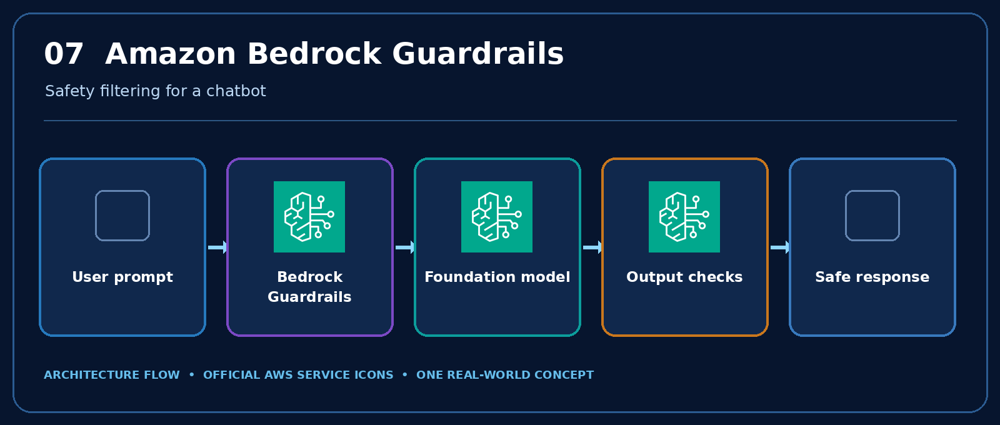

**Real-world use case — five sentences**

1. A healthcare provider builds a chatbot for administrative questions rather than clinical diagnosis.
2. Amazon Bedrock Guardrails evaluates user inputs against configured content and topic policies.
3. Approved requests are sent to a foundation model for response generation.
4. The application also evaluates generated responses for disallowed content and sensitive information.
5. Potentially unsafe requests are blocked or redirected to approved support channels.

**Architecture flow:** User prompt → Bedrock Guardrails → Foundation model → Output checks → Safe response.

---

## 8. Amazon Textract

**Architecture focus:** Invoice data extraction.

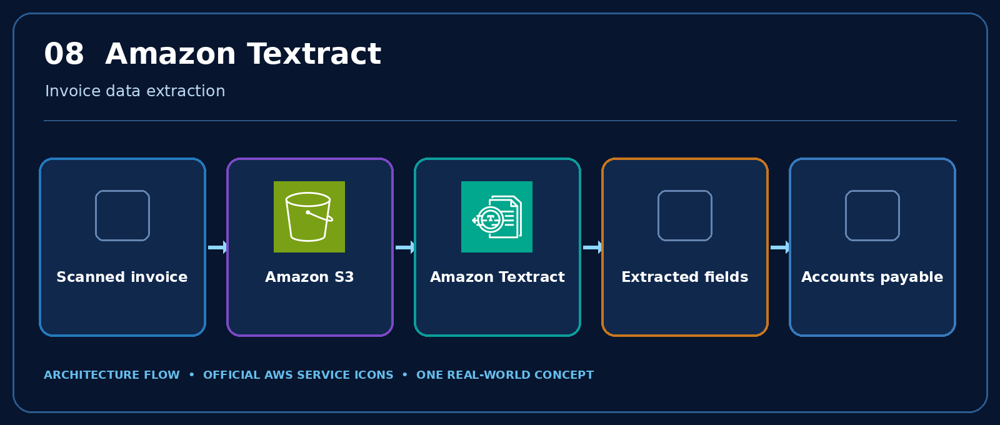

**Real-world use case — five sentences**

1. A finance department receives hundreds of supplier invoices as scanned PDFs.
2. Invoices are uploaded to Amazon S3 for controlled processing.
3. Amazon Textract extracts text and structured fields such as invoice numbers and totals.
4. Validation rules compare extracted amounts with purchase orders and flag uncertain results.
5. Accounts-payable staff approve exceptions before posting transactions to the accounting system.

**Architecture flow:** Scanned invoice → Amazon S3 → Amazon Textract → Extracted fields → Accounts payable.

---

## 9. Amazon Rekognition

**Architecture focus:** Product photo moderation.

**Real-world use case — five sentences**

1. An online marketplace allows sellers to upload product photographs.
2. Each image is stored in Amazon S3 and evaluated with Amazon Rekognition moderation capabilities.
3. The application uses returned labels and confidence scores to identify content requiring review.
4. Images that meet marketplace rules can proceed through the publication workflow.
5. Human moderators inspect flagged submissions rather than treating automated classifications as final judgments.

**Architecture flow:** Uploaded photo → Amazon S3 → Amazon Rekognition → Moderation labels → Review queue.

---

## 10. Amazon Transcribe

**Architecture focus:** Call recording transcription.

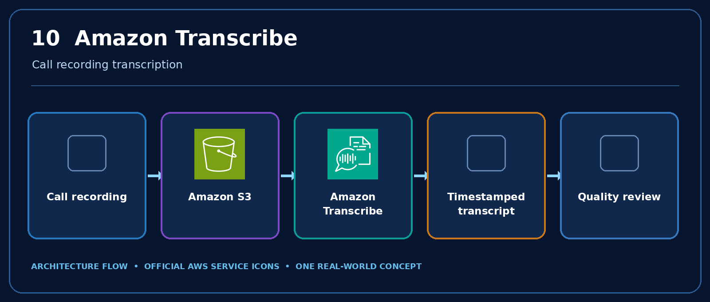

**Real-world use case — five sentences**

1. A customer support organization records calls with appropriate notice and permissions.
2. Recordings are stored in Amazon S3 with retention and access policies.
3. Amazon Transcribe converts speech into timestamped text for authorized analysis.
4. Supervisors search transcripts for recurring issues and coaching opportunities.
5. Sensitive information is protected using suitable redaction and data governance controls.

**Architecture flow:** Call recording → Amazon S3 → Amazon Transcribe → Timestamped transcript → Quality review.

---

## 11. Amazon Polly

**Architecture focus:** Spoken shipment updates.

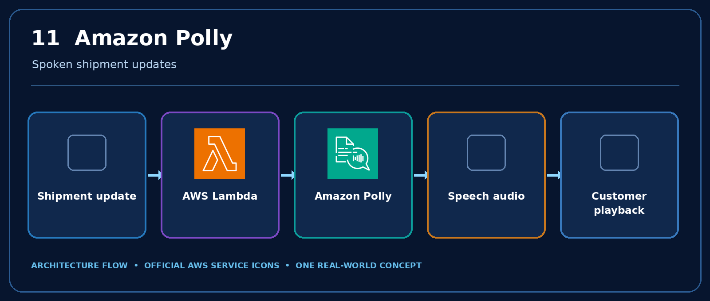

**Real-world use case — five sentences**

1. A logistics application prepares a shipment status message for a customer.
2. A Lambda function formats the message in the customer’s selected language and voice settings.
3. Amazon Polly synthesizes the text into speech audio.
4. The customer hears the update through a supported application or voice interface.
5. The team tests pronunciation and accessibility across the languages it supports.

**Architecture flow:** Shipment update → AWS Lambda → Amazon Polly → Speech audio → Customer playback.

---

## 12. Amazon Translate

**Architecture focus:** Multilingual support ticket routing.

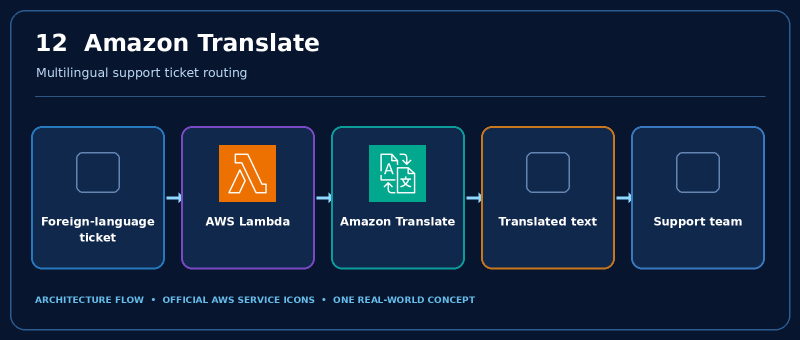

**Real-world use case — five sentences**

1. A global help desk receives a support request written in a language unfamiliar to its assigned team.
2. The application sends the ticket text to Amazon Translate.
3. The translated version is attached to the ticket while preserving the original message.
4. A support agent reviews the translation and asks for clarification when wording is ambiguous.
5. The organization protects customer data and uses human review for high-impact communications.

**Architecture flow:** Foreign-language ticket → AWS Lambda → Amazon Translate → Translated text → Support team.

---

## 13. Amazon Comprehend

**Architecture focus:** Customer feedback sentiment analysis.

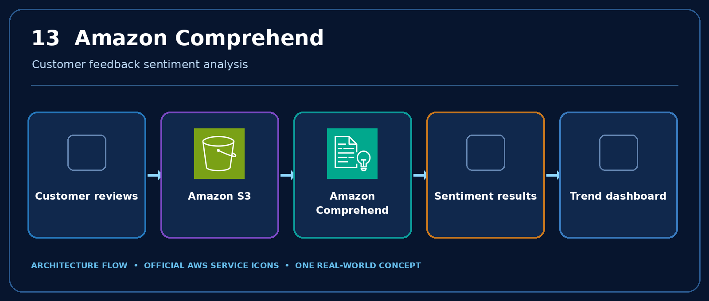

**Real-world use case — five sentences**

1. A hotel chain gathers customer feedback from post-stay surveys.
2. The feedback is stored in Amazon S3 for batch processing.
3. Amazon Comprehend identifies sentiment and useful entities in the text.
4. Analysts aggregate the results to spot recurring complaints about cleanliness or check-in delays.
5. Managers compare automated findings with representative reviews before making service changes.

**Architecture flow:** Customer reviews → Amazon S3 → Amazon Comprehend → Sentiment results → Trend dashboard.

---

## 14. Amazon Lex

**Architecture focus:** Self-service appointment booking.

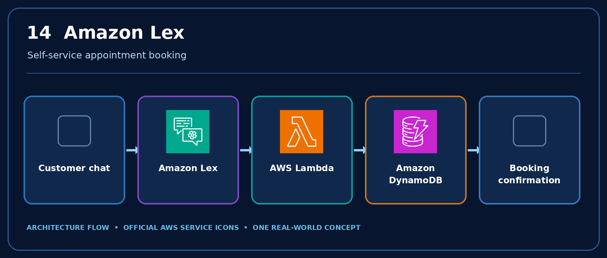

**Real-world use case — five sentences**

1. A clinic offers a conversational assistant for non-emergency appointment booking.
2. Amazon Lex recognizes the appointment intent and collects required date and location details.
3. A Lambda function checks available slots in an authorized booking database.
4. The customer confirms the selected time before the reservation is saved.
5. The chatbot provides a staff contact path when the request cannot be completed automatically.

**Architecture flow:** Customer chat → Amazon Lex → AWS Lambda → Amazon DynamoDB → Booking confirmation.

---

## 15. Amazon Personalize

**Architecture focus:** Retail product recommendations.

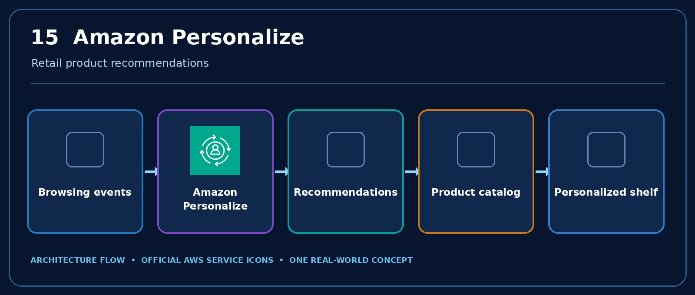

**Real-world use case — five sentences**

1. An e-commerce site records consented browsing and purchase interactions.
2. Amazon Personalize uses the interaction data to produce item recommendations.
3. The storefront requests recommendations when a customer opens a product page.
4. The application filters out unavailable products before showing the personalized selection.
5. Merchandising teams measure conversion and monitor whether recommendations remain relevant.

**Architecture flow:** Browsing events → Amazon Personalize → Recommendations → Product catalog → Personalized shelf.

---

## 16. Amazon Forecast

**Architecture focus:** Historical retail demand planning (legacy).

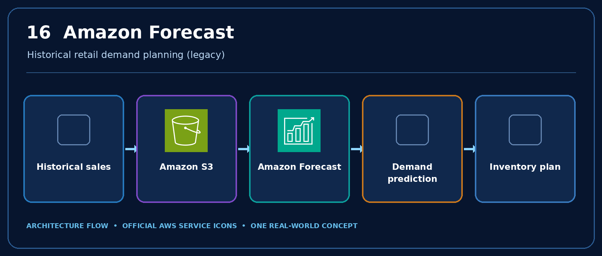

**Real-world use case — five sentences**

1. A retailer combines historical sales and seasonal patterns to estimate future inventory needs.
2. Historical datasets are organized in Amazon S3 for forecasting workflows.
3. An existing Amazon Forecast deployment can generate demand predictions from the time series.
4. Planners compare predictions with promotions and supplier lead times before ordering stock.
5. Because Amazon Forecast is a legacy service, teams should verify availability and evaluate supported alternatives for new implementations.

**Architecture flow:** Historical sales → Amazon S3 → Amazon Forecast → Demand prediction → Inventory plan.

---

## 17. Amazon Kendra

**Architecture focus:** Internal document search.

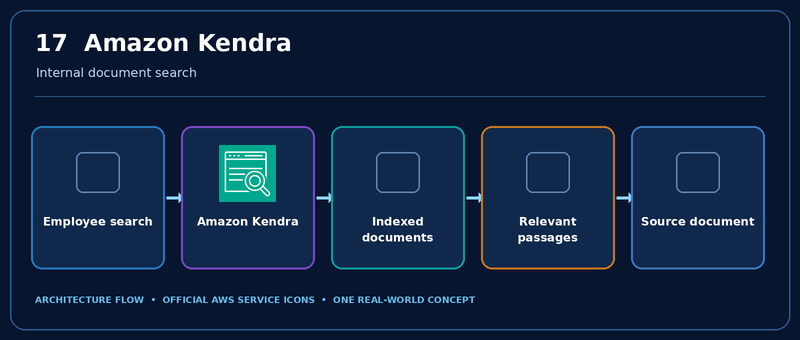

**Real-world use case — five sentences**

1. A legal operations team needs to find clauses across an approved collection of internal documents.
2. Amazon Kendra indexes the permitted content and makes it searchable.
3. An employee enters a natural-language query about contract renewal terms.
4. Search results identify relevant documents and passages for the employee to inspect.
5. Access permissions and document freshness remain important parts of the search design.

**Architecture flow:** Employee search → Amazon Kendra → Indexed documents → Relevant passages → Source document.

---

## 18. Amazon Connect AI capabilities

**Architecture focus:** Contact center agent assistance.

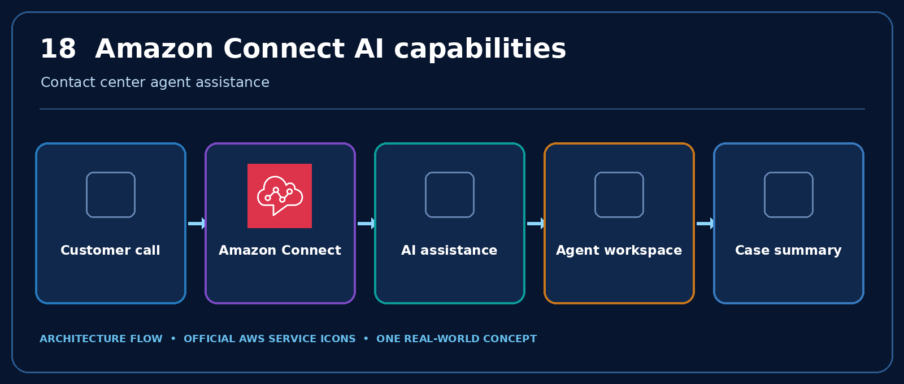

**Real-world use case — five sentences**

1. A contact center handles billing inquiries across many customer accounts.
2. Amazon Connect routes incoming interactions to available agents based on configured flows.
3. Supported AI assistance features can surface relevant guidance and summarize conversations.
4. The agent checks account information and verifies recommendations before making changes.
5. Supervisors use quality reviews and operational metrics to improve the experience.

**Architecture flow:** Customer call → Amazon Connect → AI assistance → Agent workspace → Case summary.

---

## 19. Amazon Bedrock AgentCore

**Architecture focus:** Secure production agent runtime.

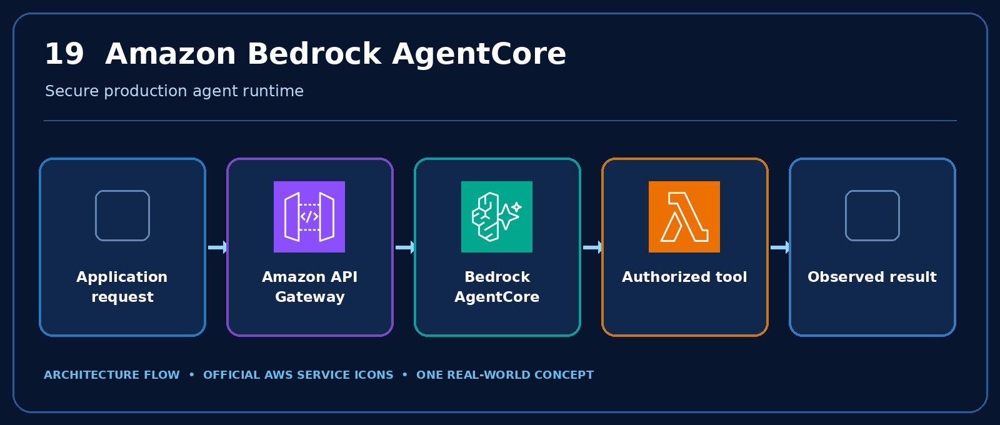

**Real-world use case — five sentences**

1. A software company deploys an AI agent that performs routine IT service tasks.
2. Its application authenticates requests before passing them to an AgentCore-hosted agent.
3. The agent calls only tools that are permitted for the requesting user.
4. Operational telemetry helps the team investigate failures and monitor performance.
5. Administrators enforce access boundaries and review actions that could affect production systems.

**Architecture flow:** Application request → Amazon API Gateway → Bedrock AgentCore → Authorized tool → Observed result.

---

## 20. Amazon Nova

**Architecture focus:** Multimodal product description generation.

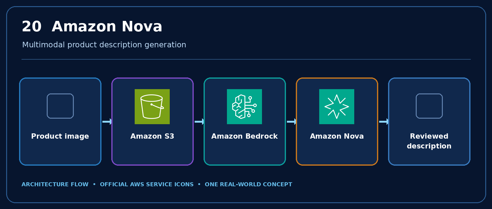

**Real-world use case — five sentences**

1. An online retailer needs consistent descriptions for thousands of product photographs.
2. Product images are stored in Amazon S3 with catalog identifiers.
3. The application uses a supported Amazon Nova model through Amazon Bedrock to draft descriptions.
4. Editors verify the descriptions against actual product specifications and remove unsupported claims.
5. Approved copy is published to the product catalog for customer browsing.

**Architecture flow:** Product image → Amazon S3 → Amazon Bedrock → Amazon Nova → Reviewed description.

---

## 21. Amazon Titan

**Architecture focus:** Semantic embeddings for search.

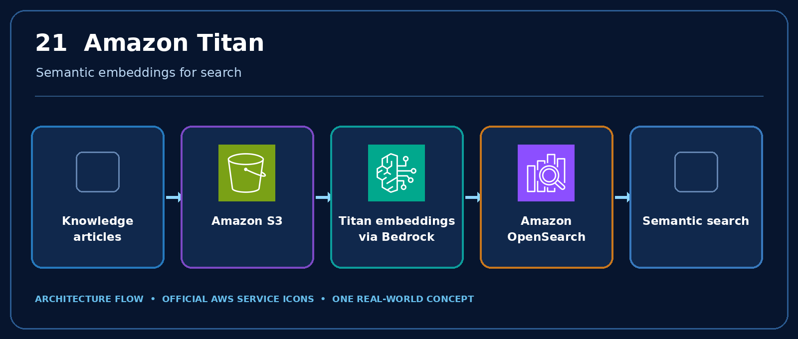

**Real-world use case — five sentences**

1. An IT organization maintains a large collection of technical troubleshooting articles.
2. Articles are ingested from Amazon S3 and converted into vector embeddings using an Amazon Titan embedding model.
3. The vectors are stored in an appropriately configured OpenSearch index.
4. A user query is embedded and matched against relevant knowledge articles.
5. The application displays the matching sources so engineers can verify the guidance.

**Architecture flow:** Knowledge articles → Amazon S3 → Titan embeddings via Bedrock → Amazon OpenSearch → Semantic search.

---

## 22. Amazon Bedrock Flows

**Architecture focus:** Multi-step document review workflow.

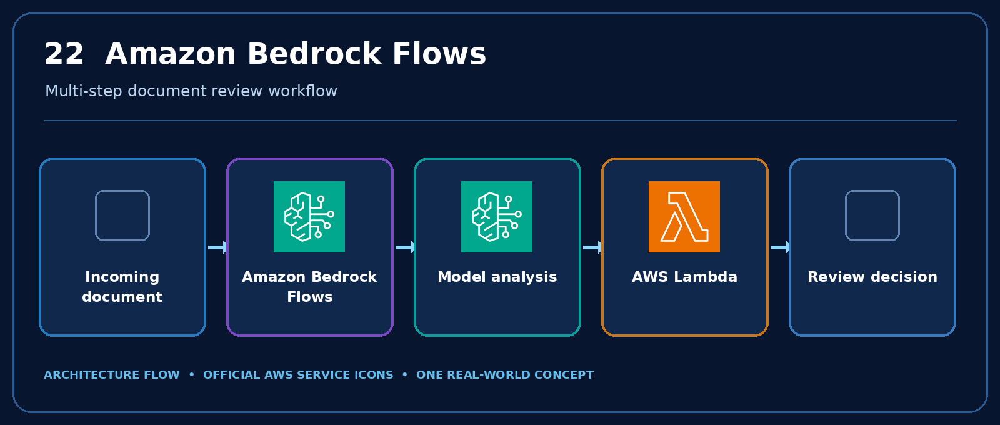

**Real-world use case — five sentences**

1. An insurance team receives documents that must be classified and summarized.
2. Amazon Bedrock Flows coordinates a sequence of model and application steps.
3. A model analyzes the document and produces a structured summary.
4. A Lambda function applies business rules and routes exceptions for manual review.
5. The final workflow records decisions for audit and operational follow-up.

**Architecture flow:** Incoming document → Amazon Bedrock Flows → Model analysis → AWS Lambda → Review decision.

---

## 23. Amazon Bedrock Data Automation

**Architecture focus:** Extract information from mixed media.

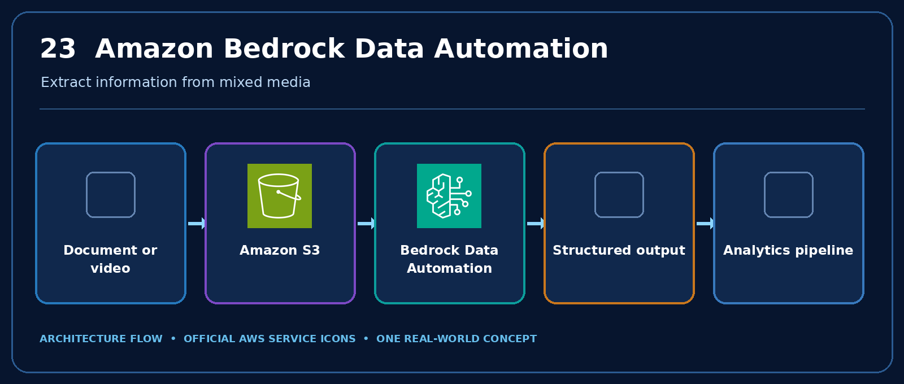

**Real-world use case — five sentences**

1. A media organization receives large volumes of videos and documents from content partners.
2. Source assets are stored in Amazon S3 with appropriate permissions.
3. Amazon Bedrock Data Automation extracts useful structured information from supported inputs.
4. The resulting data is validated before being sent to downstream analytics workflows.
5. Reviewers investigate extraction failures and quality issues before publishing metadata.

**Architecture flow:** Document or video → Amazon S3 → Bedrock Data Automation → Structured output → Analytics pipeline.

---

## 24. Amazon Bedrock Prompt Management

**Architecture focus:** Versioned customer-service prompts.

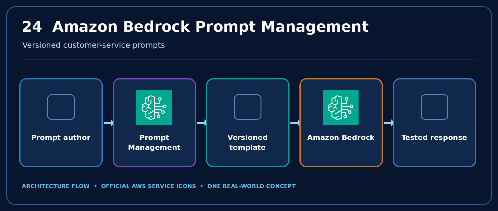

**Real-world use case — five sentences**

1. A customer service team maintains prompts for several chatbot workflows.
2. Amazon Bedrock Prompt Management stores reusable prompt templates and versions.
3. Developers test a candidate prompt against representative customer questions.
4. An approved version is used by the application when invoking a foundation model.
5. The team compares response quality before promoting later prompt revisions.

**Architecture flow:** Prompt author → Prompt Management → Versioned template → Amazon Bedrock → Tested response.

---

## 25. Amazon SageMaker Unified Studio

**Architecture focus:** Collaborative analytics and AI development.

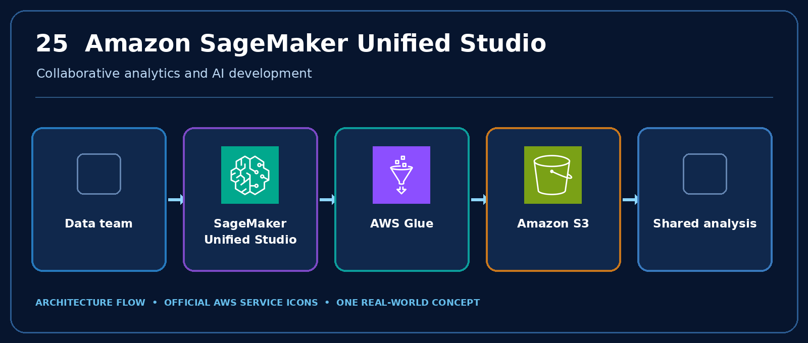

**Real-world use case — five sentences**

1. A retail analytics team collaborates on a demand analysis project.
2. Team members use SageMaker Unified Studio to work with governed data and development assets.
3. Supported integrations help them prepare datasets and build analytical workflows.
4. Results are shared with authorized stakeholders for validation.
5. Administrators maintain access policies and monitor the lifecycle of project resources.

**Architecture flow:** Data team → SageMaker Unified Studio → AWS Glue → Amazon S3 → Shared analysis.

---

## 26. AWS Trainium

**Architecture focus:** Large model training on AWS compute.

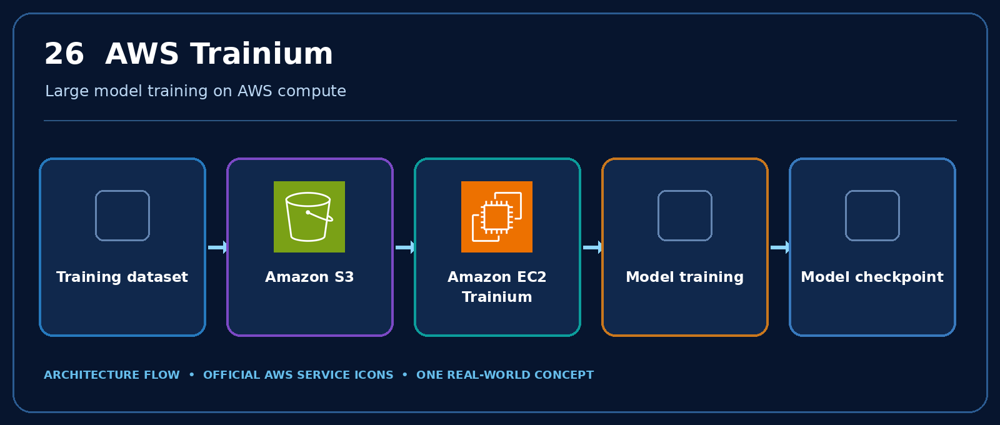

**Real-world use case — five sentences**

1. An AI research team needs to train a large model using specialized accelerator hardware.
2. The training dataset and checkpoints are stored in Amazon S3.
3. The team provisions compatible EC2 instances powered by AWS Trainium accelerators.
4. Training jobs use an appropriate software stack and save checkpoints for recovery.
5. Engineers monitor throughput, training quality, and total compute cost.

**Architecture flow:** Training dataset → Amazon S3 → Amazon EC2 Trainium → Model training → Model checkpoint.

---

## 27. AWS Inferentia

**Architecture focus:** Cost-optimized model inference.

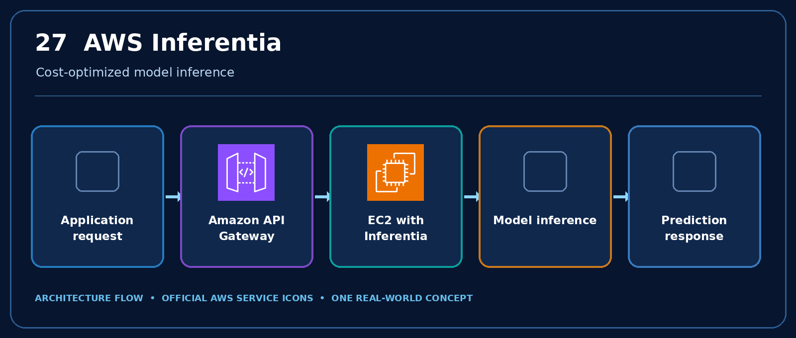

**Real-world use case — five sentences**

1. A digital service needs to serve a trained model at steady production traffic levels.
2. Requests enter through an application endpoint that performs authentication and validation.
3. A model server runs on compatible Amazon EC2 instances equipped with AWS Inferentia accelerators.
4. The inference service returns predictions to the application within its latency target.
5. Engineers benchmark performance and cost against other supported inference options.

**Architecture flow:** Application request → Amazon API Gateway → EC2 with Inferentia → Model inference → Prediction response.

---

## 28. Strands Agents SDK

**Architecture focus:** Tool-using support agent built in Python.

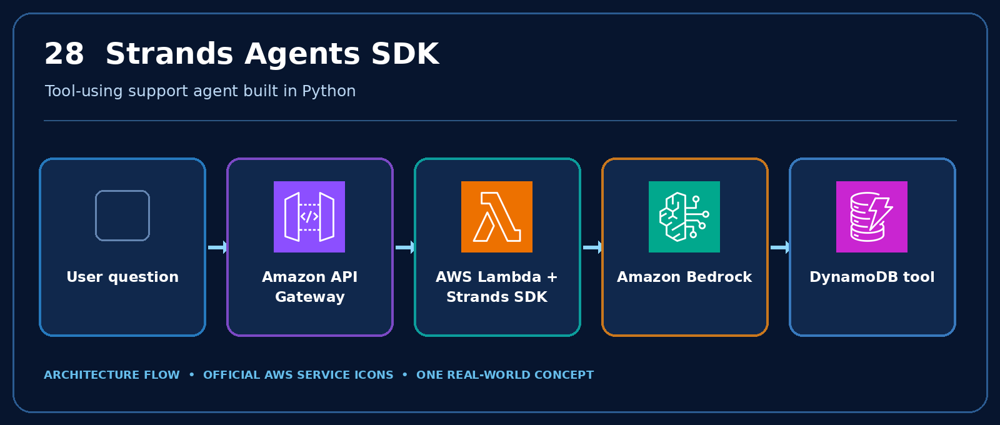

**Real-world use case — five sentences**

1. A developer builds a support agent using the open-source Strands Agents SDK.
2. An API Gateway endpoint sends authorized requests to an application running the agent code.
3. The agent uses a supported model through Amazon Bedrock to interpret the user’s request.
4. When needed, the application invokes a controlled tool to read relevant records from DynamoDB.
5. The developer tests tool permissions, error handling, and response quality before production release.

**Architecture flow:** User question → Amazon API Gateway → AWS Lambda + Strands SDK → Amazon Bedrock → DynamoDB tool.

---

## Icon attribution and implementation notes

All pictorial service icons are taken from the AWS Architecture Icons ZIP supplied by the user. Labels for concepts without a dedicated service icon in the supplied pack are shown as text-only stages. The Amazon Q icon represents both Q Developer and Q Business, with distinct labels; Amazon Bedrock is used for features that do not have their own dedicated icon. AWS Trainium and AWS Inferentia are shown with the official Amazon EC2 icon and explicitly labeled accelerator hardware, not fabricated chip icons. Strands Agents SDK is shown as application code in AWS Lambda, not as an invented AWS service icon. Architecture examples are illustrative and should be validated for service availability, pricing, security, and supported integrations.
