# AWS AI Services — Architecture Infographics and Real-World Use Cases

> **Illustrated reference guide** | 18 recovered diagrams | Five practical use-case sentences beneath each infographic

This guide brings together the available diagrams generated in the conversation. The images are conceptual teaching visuals, not deployment-ready AWS reference architectures; verify service availability, permissions, supported integrations, and current AWS documentation before implementation.

## Table of contents

1. [Amazon Bedrock Knowledge Bases — RAG Document Assistant](#diagram-1)
2. [Amazon Bedrock Guardrails — Safe Generative AI Responses](#diagram-2)
3. [Amazon Kendra — Enterprise Knowledge Search](#diagram-3)
4. [Amazon Bedrock Flows — Automated Generative AI Workflow](#diagram-4)
5. [AWS Inferentia — Cost-Efficient Model Inference](#diagram-5)
6. [Amazon Nova — Multimodal AI Content Generation](#diagram-6)
7. [AWS Trainium — Large Model Training](#diagram-7)
8. [Amazon Bedrock Prompt Management — Reusable Versioned Prompts](#diagram-8)
9. [Amazon Polly — Text-to-Speech Notifications](#diagram-9)
10. [Amazon Comprehend — Customer Review Sentiment Analysis](#diagram-10)
11. [Amazon Personalize — Personalized Product Recommendations](#diagram-11)
12. [Amazon Lex — Customer Service Chatbot](#diagram-12)
13. [Amazon Connect AI Capabilities — AI-Assisted Contact Center](#diagram-13)
14. [Amazon SageMaker Unified Studio — Unified Data and ML Development](#diagram-14)
15. [Amazon Titan — Document Summarization](#diagram-15)
16. [Amazon Lex — Alternative Architecture — Conversational AI with Business Actions](#diagram-16)
17. [Amazon Bedrock Data Automation — Intelligent Invoice Processing](#diagram-17)
18. [Strands Agents SDK — Tool-Using AI Operations Agent](#diagram-18)

---

## 01. Amazon Bedrock Knowledge Bases
**Concept:** RAG Document Assistant

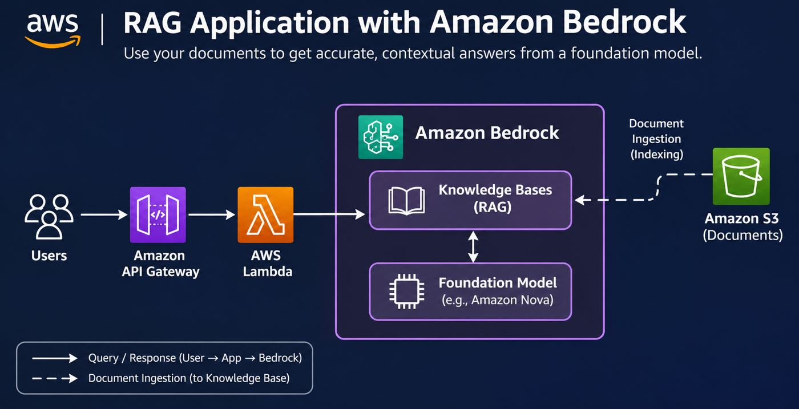

**Real-world use case — five sentences**

1. A corporate employee asks a chatbot how to complete an internal procurement request.
2. Company policy PDFs stored in Amazon S3 are indexed by Amazon Bedrock Knowledge Bases.
3. The application retrieves relevant passages and supplies them as context to a foundation model.
4. The model returns a grounded answer that the employee can use without manually searching every policy.
5. This approach is useful for internal help desks, HR portals, and technical knowledge assistants.

---

## 02. Amazon Bedrock Guardrails
**Concept:** Safe Generative AI Responses

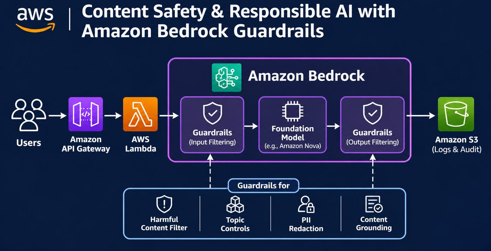

**Real-world use case — five sentences**

1. A bank deploys a generative AI assistant to answer general customer questions.
2. Amazon Bedrock Guardrails evaluates requests and responses against configured content policies.
3. The guardrail can block disallowed topics and help detect sensitive information.
4. Approved responses are returned to the customer while flagged content is handled according to policy.
5. This helps teams add consistent safety controls to customer-facing AI applications.

---

## 03. Amazon Kendra
**Concept:** Enterprise Knowledge Search

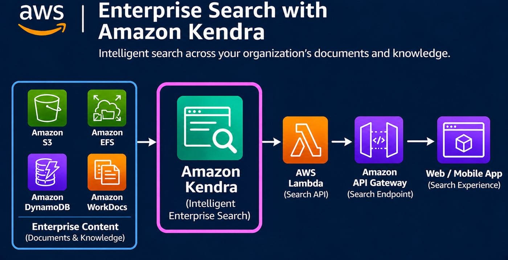

**Real-world use case — five sentences**

1. An employee searches for the latest troubleshooting procedure across company documents.
2. Amazon Kendra indexes supported enterprise content and makes it searchable.
3. The search application sends the query through an API and retrieves ranked results.
4. The employee opens the relevant policy or runbook rather than browsing multiple repositories.
5. This is useful for enterprise intranets, IT support portals, and document discovery.

---

## 04. Amazon Bedrock Flows
**Concept:** Automated Generative AI Workflow

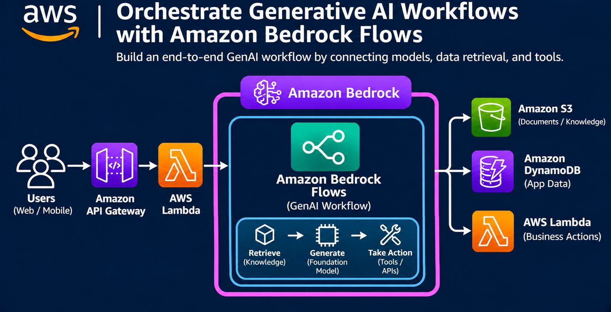

**Real-world use case — five sentences**

1. A customer submits a question that requires both company knowledge and an application action.
2. Amazon Bedrock Flows coordinates retrieval, foundation-model processing, and connected tools.
3. The workflow can use information stored in Amazon S3 and application records in DynamoDB.
4. A Lambda-backed action can perform an approved business operation after the required checks.
5. This pattern suits customer-service workflows that combine reasoning with deterministic steps.

---

## 05. AWS Inferentia
**Concept:** Cost-Efficient Model Inference

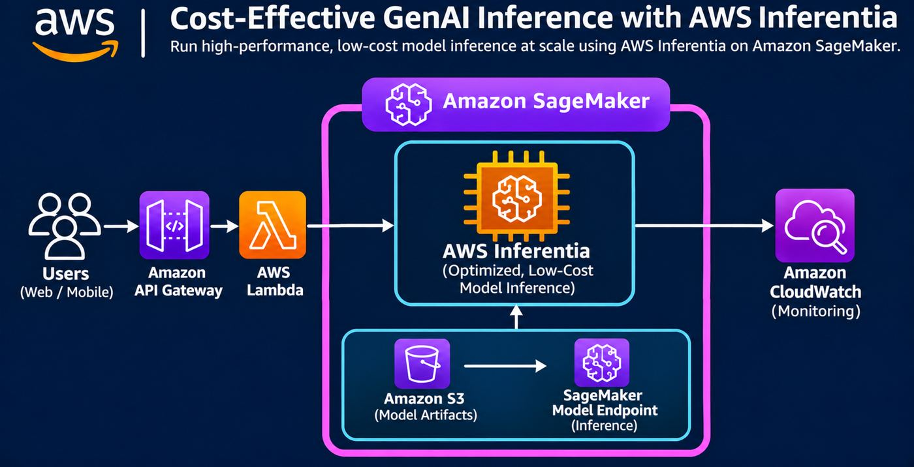

**Real-world use case — five sentences**

1. An online service needs to serve a large volume of machine-learning predictions.
2. The team deploys a compatible model on an inference endpoint using AWS Inferentia-based compute.
3. Incoming application requests reach the endpoint through the backend API.
4. Amazon CloudWatch monitors operational metrics and helps engineers identify performance issues.
5. This architecture is useful when inference throughput and infrastructure cost are important.

---

## 06. Amazon Nova
**Concept:** Multimodal AI Content Generation

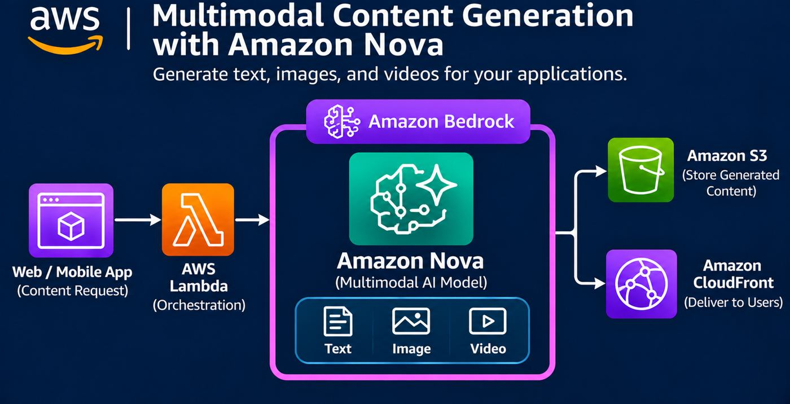

**Real-world use case — five sentences**

1. A marketing team uses an application to request AI-generated campaign content.
2. A Lambda backend invokes an appropriate Amazon Nova model through Amazon Bedrock.
3. Different Nova models can support text, image, or video-related workloads according to their capabilities.
4. Generated assets can be stored in Amazon S3 and distributed using CloudFront.
5. This is useful for content-production pipelines and creative application features.

---

## 07. AWS Trainium
**Concept:** Large Model Training

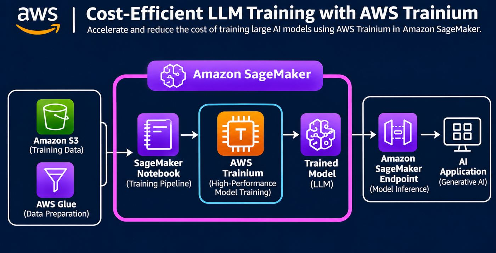

**Real-world use case — five sentences**

1. An AI team wants to train or fine-tune a large model on a substantial dataset.
2. Training data is prepared with AWS Glue and stored in Amazon S3.
3. A compatible training workload uses Trainium-powered compute through an AWS-supported training environment.
4. The trained model artifacts are saved for evaluation and subsequent deployment.
5. This approach is relevant to teams optimizing the cost and scale of model training.

---

## 08. Amazon Bedrock Prompt Management
**Concept:** Reusable Versioned Prompts

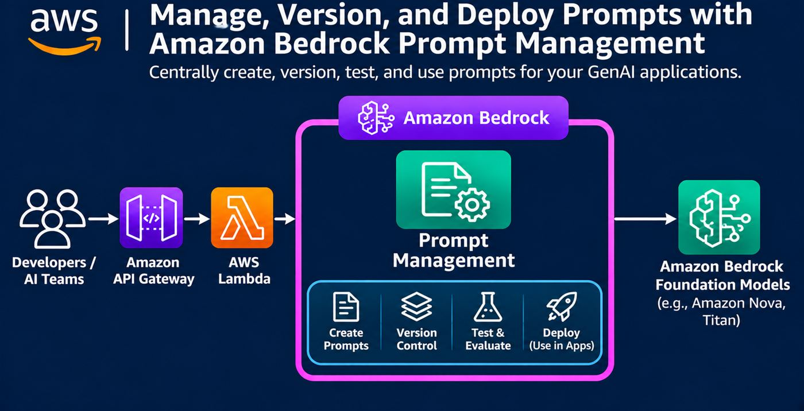

**Real-world use case — five sentences**

1. A company maintains one approved prompt for answering customer refund questions.
2. Developers create and test prompt variants using Amazon Bedrock Prompt Management.
3. Versions let the team track which prompt configuration is used by an application.
4. The backend invokes the chosen prompt with the appropriate foundation model.
5. This is valuable when several applications need consistent and maintainable AI instructions.

---

## 09. Amazon Polly
**Concept:** Text-to-Speech Notifications

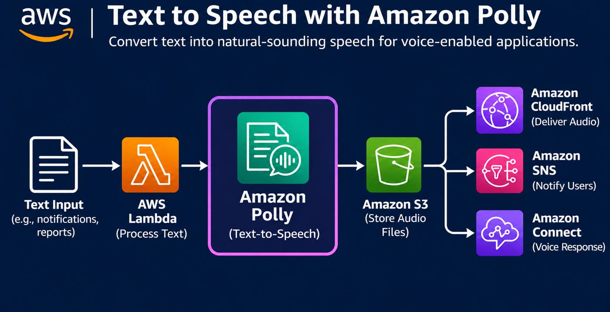

**Real-world use case — five sentences**

1. A service generates a spoken version of an important text announcement.
2. AWS Lambda sends the text to Amazon Polly for speech synthesis.
3. The generated audio file is saved to Amazon S3.
4. CloudFront can deliver the audio to listeners while SNS can send a separate completion notification.
5. This is useful for accessibility, spoken alerts, and multilingual voice experiences.

---

## 10. Amazon Comprehend
**Concept:** Customer Review Sentiment Analysis

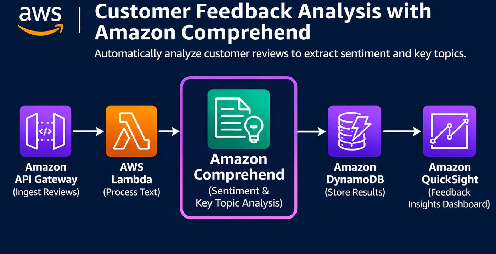

**Real-world use case — five sentences**

1. An e-commerce platform collects thousands of written customer reviews.
2. An API receives the reviews and AWS Lambda prepares the text for analysis.
3. Amazon Comprehend detects sentiment and can identify useful entities or phrases.
4. The application stores results in DynamoDB and prepares them for reporting.
5. This helps product teams identify negative feedback trends and improve customer experience.

---

## 11. Amazon Personalize
**Concept:** Personalized Product Recommendations

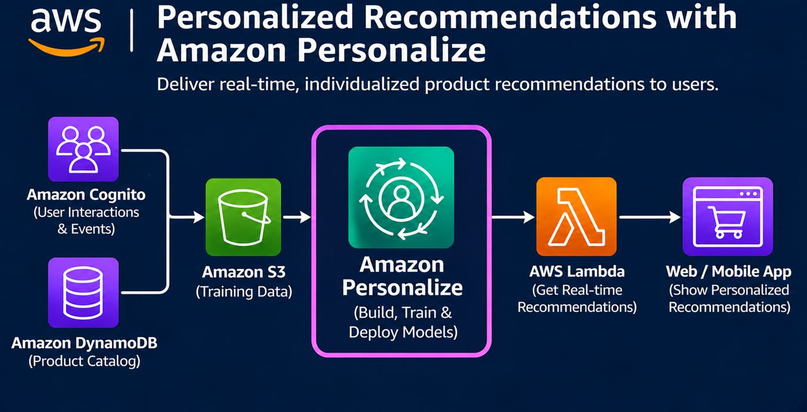

**Real-world use case — five sentences**

1. An online store wants each shopper to see products relevant to their interests.
2. The platform collects product metadata and user interaction events for its recommendation dataset.
3. Amazon Personalize trains recommendation models from the prepared data.
4. An application backend requests recommendations for a particular user and displays the returned items.
5. This is useful for retail discovery, media recommendations, and personalized browsing.

---

## 12. Amazon Lex
**Concept:** Customer Service Chatbot

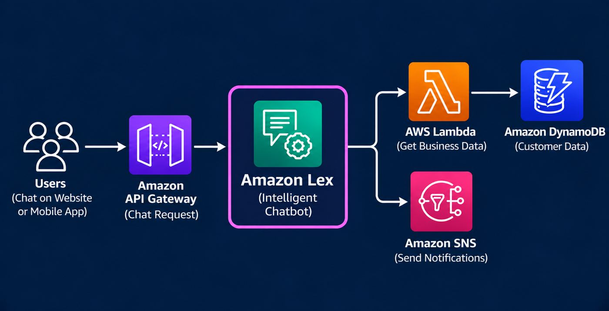

**Real-world use case — five sentences**

1. A customer asks a website chatbot for the status of an order.
2. Amazon Lex identifies the intent and gathers required information such as an order number.
3. A Lambda fulfillment function retrieves the order status from DynamoDB.
4. The bot responds with the status and can trigger a notification when appropriate.
5. This reduces repetitive contact-center work while preserving a conversational interface.

---

## 13. Amazon Connect AI Capabilities
**Concept:** AI-Assisted Contact Center

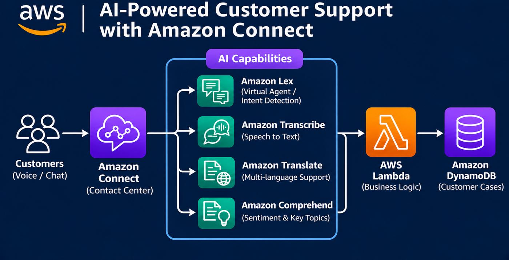

**Real-world use case — five sentences**

1. A customer calls a support center to report a delivery problem.
2. Amazon Connect manages the contact and can integrate with Amazon Lex for self-service.
3. Speech transcription and language analysis can assist supported contact-center workflows.
4. AWS Lambda retrieves or updates customer case information stored in DynamoDB.
5. This enables faster routing, contextual assistance, and better support operations.

---

## 14. Amazon SageMaker Unified Studio
**Concept:** Unified Data and ML Development

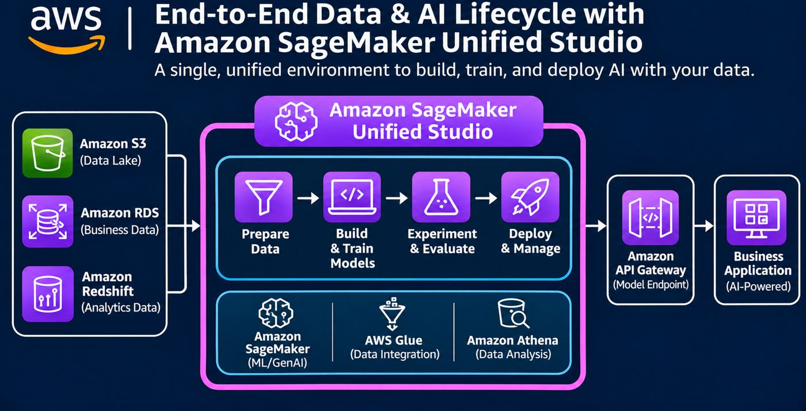

**Real-world use case — five sentences**

1. A data science team develops a model to predict customer churn.
2. They access business datasets from services such as S3, RDS, and Redshift.
3. Amazon SageMaker Unified Studio provides a shared workspace for supported data and AI development workflows.
4. The team prepares data, experiments with models, and integrates deployment services as needed.
5. This is useful when analysts, engineers, and ML practitioners collaborate on a common project.

---

## 15. Amazon Titan
**Concept:** Document Summarization

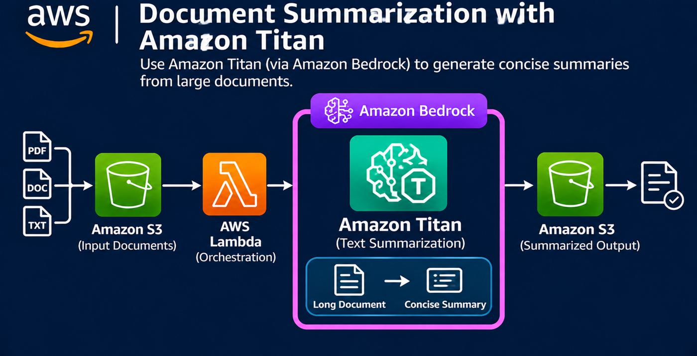

**Real-world use case — five sentences**

1. A legal operations team needs short summaries of lengthy case documents.
2. Documents are uploaded to Amazon S3 and extracted into usable text by an application workflow.
3. Lambda invokes a suitable Amazon Titan text model through Amazon Bedrock, where available.
4. The generated summaries are saved to S3 for review by staff.
5. This workflow helps accelerate document triage while keeping humans responsible for verification.

---

## 16. Amazon Lex — Alternative Architecture
**Concept:** Conversational AI with Business Actions

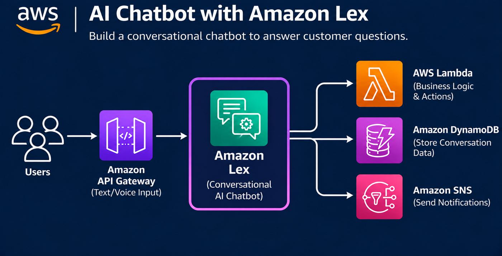

**Real-world use case — five sentences**

1. A service desk chatbot helps employees reset a non-sensitive application preference.
2. The application forwards user requests to Amazon Lex to determine the intended action.
3. A Lambda fulfillment function checks permissions and performs the allowed operation.
4. DynamoDB records the relevant application state and SNS can send an update.
5. This design demonstrates how a conversational interface can initiate controlled backend actions.

---

## 17. Amazon Bedrock Data Automation
**Concept:** Intelligent Invoice Processing

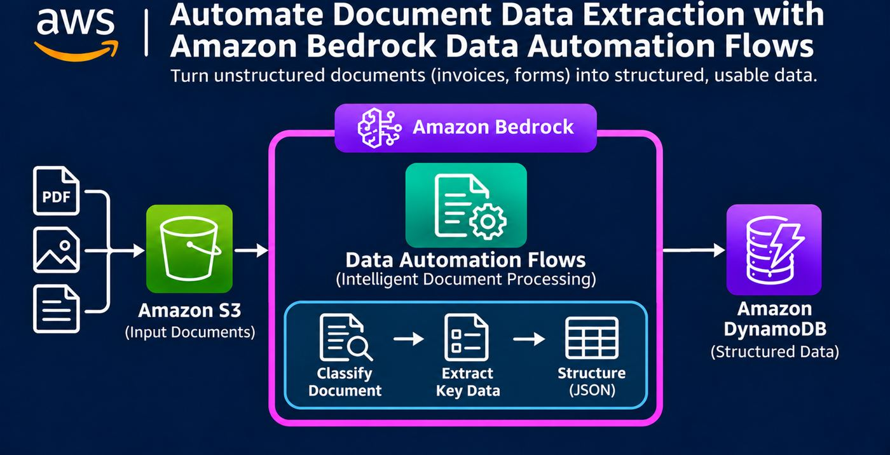

**Real-world use case — five sentences**

1. An accounts-payable team receives a large volume of supplier invoices.
2. Invoices are uploaded to Amazon S3 for automated processing.
3. Amazon Bedrock Data Automation extracts structured information from supported documents.
4. An application validates the extracted fields and writes approved records to DynamoDB.
5. This reduces repetitive manual entry while retaining checks for exceptions and errors.

---

## 18. Strands Agents SDK
**Concept:** Tool-Using AI Operations Agent

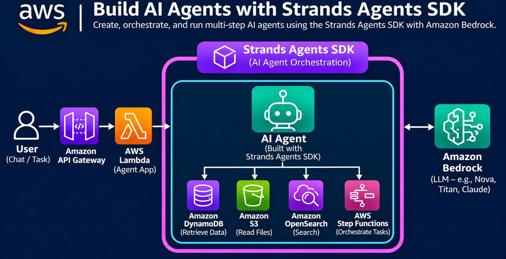

**Real-world use case — five sentences**

1. An operations engineer asks an AI assistant to investigate a failed application deployment.
2. A Strands-based agent running in Lambda can use an Amazon Bedrock model for reasoning.
3. The agent calls authorized tools to search operational information and retrieve relevant records.
4. It can invoke a Step Functions workflow for approved remediation steps when configured to do so.
5. This pattern is useful for controlled DevOps assistance and multi-step operational tasks.

---

## Earlier diagrams not recoverable in this file package

The following infographic images appeared earlier in the conversation but their original image files were not available in the current working directory. They are intentionally **not** replaced with invented or mismatched images.

- Amazon Bedrock (general overview)
- Amazon SageMaker AI
- Amazon Q Developer
- Amazon Q Business
- Amazon Bedrock Agents
- Amazon Textract
- Amazon Rekognition
- Amazon Transcribe
- Amazon Translate
- Amazon Forecast
- Amazon Bedrock AgentCore

## How to use this guide

Open this Markdown file in VS Code, GitHub, or a Markdown viewer with the accompanying `images/` folder intact. For the images to display, keep the Markdown file and the `images` directory at the same relative locations.
